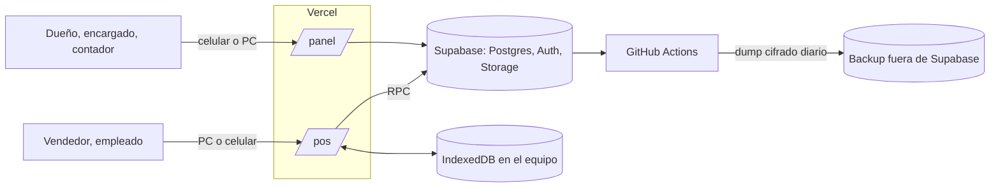
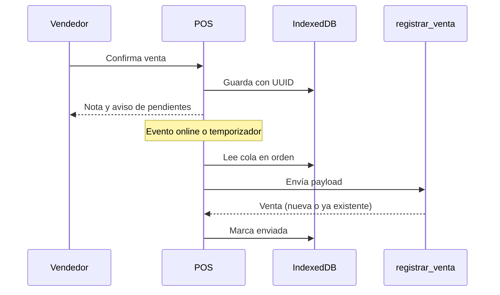

# Arquitectura — ERP Multitiendas

Una sola app Next.js con dos superficies, `/panel` y `/pos`, sobre una base Supabase. Las reglas de dinero y stock
viven en Postgres; la app presenta y valida en el borde.

## Contexto



## Decisiones

| ID | Decisión | Motivo | Descartado |
|---|---|---|---|
| ADR-01 | Una app Next.js con un despliegue y un login | Menos que mantener; el rol define el acceso | Dos apps, app de escritorio |
| ADR-02 | Una base con `negocio_id` y RLS | Datos separados con un solo esquema | Una base por negocio |
| ADR-03 | Escrituras sensibles por RPC en Postgres | Transacción, permisos e idempotencia en un solo lugar | Lógica en server actions |
| ADR-04 | Kardex append-only, `stock` como caché | Trazabilidad y reconciliación | Editar stock directo |
| ADR-05 | Venta offline append-only | Cumple sin sincronizar en dos direcciones | Sincronización completa, servidor local |
| ADR-06 | Dinero en Bs, USD solo como base de precio | El cliente cobra en Bs y QR (P-03) | Caja multimoneda |
| ADR-07 | Nota por impresión del navegador o PDF | Hardware sin definir; funciona en cualquier equipo | ESC/POS, cajón electrónico |
| ADR-08 | Insumos como productos con kardex | Reutiliza el inventario | Módulo aparte |
| ADR-09 | Módulos por dominio, importación solo por `index.ts` | Cambios locales y límites claros | Carpetas por tipo técnico |
| ADR-10 | Entrega por fases: A con el contrato y lo imprescindible, B con los extras | Protege acta y saldo | Todo junto |

Decisiones de proveedor y costo: `docs/stack.md`.

## Estructura del repositorio

Estructura objetivo: `web/`, `supabase/` y `scripts/` se crean en la fase 0.

```
web/
  src/
    app/
      (auth)/login/
      (panel)/panel/<modulo>/      páginas del ERP
      (pos)/pos/                   POS con service worker
    modules/
      catalogo/ inventario/ ventas/ caja/ clientes/ lavanderia/
      reportes/ usuarios/ credito/ reservas/ compras/
    lib/
      supabase/   clientes de servidor y navegador
      offline/    cola Dexie y envío
      format/     moneda y fechas
    components/ui/  shadcn
    proxy.ts        refresco de sesión
  tests/e2e/
supabase/
  migrations/  seed.sql  tests/  functions/admin-usuarios/
scripts/importacion/
.github/workflows/
docs/
```

Cada módulo sigue la misma forma:

```
modules/ventas/
  index.ts       API pública del módulo
  schemas.ts     Zod
  queries.ts     lecturas
  actions.ts     server actions que llaman RPC
  domain.ts      funciones puras
  domain.test.ts
  components/
```

## Capas

| Capa | Responsabilidad | No hace |
|---|---|---|
| Páginas (`app/`) | Componen datos y componentes; Server Components por defecto | Reglas de negocio |
| Módulos | Validan con Zod, llaman RPC, leen datos | Calcular stock o saldos definitivos |
| `lib/` | Infraestructura compartida | Conocer dominios |
| Postgres | Transacciones, permisos, kardex, RLS | Presentación |

## Flujo de venta sin conexión



Reglas:

- El POS guarda siempre en la cola y envía desde ahí. Con y sin conexión siguen el mismo camino.
- Un error de red reintenta con backoff. Un error de validación deja la venta visible para revisión; nunca se borra.
- Cerrar caja exige cola vacía.
- El panel no usa service worker: sin conexión muestra "sin conexión", nunca datos viejos.

## Seguridad

- Supabase Auth con sesión en cookies y `proxy.ts`, según el patrón SSR de `@supabase/ssr`.
- La clave `anon` es pública; la protección real es RLS. `service_role` solo en scripts de importación, backups y la
  Edge Function `admin-usuarios`, nunca en `web/`.
- Crear o desactivar cuentas exige la API admin de Auth. Lo hace `admin-usuarios`, que verifica el JWT del llamador y
  `tiene_permiso(negocio_id, 'usuarios')` antes de actuar.
- RPC con `security definer`, `set search_path = ''` y verificación de `tiene_permiso`.
- `revoke` de escritura directa en tablas contables.
- Fotos en un bucket con policies por negocio.
- Encabezados de seguridad en `next.config`.
- Lectura de la matriz en cada RPC: ocultar un botón no es control de acceso.
- CI, teléfonos y datos de crédito no van a logs.

## Datos y operación

- Migraciones versionadas con Supabase CLI. Nunca cambios manuales en producción.
- Tipos generados con `supabase gen types` y verificados en CI.
- Backups, restauración y alertas: `docs/stack.md` y RNF-08.
- Entornos: local con Supabase CLI, preview de Vercel contra un proyecto de prueba, producción. El cupo de 2 proyectos
  Free debe revisarse antes de crear el de prueba.
