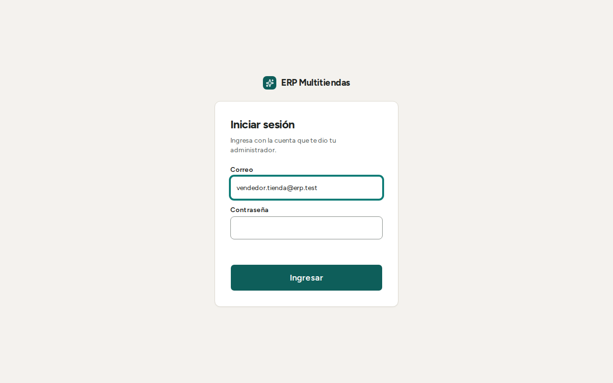
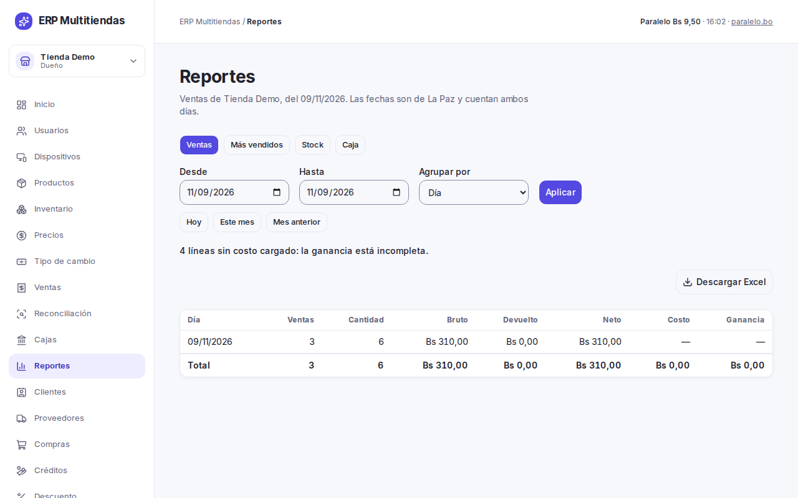

# Manual del contador: panel de consulta y reportes

Este manual es para el contador de un negocio (tienda, frial de carnes al vacío o lavandería). El contador mira el panel de
administración para controlar ventas, cajas, inventario y costos. No vende, no anula, no devuelve y no edita datos, salvo una excepción: en "Reconciliación" puede confirmar los cobros por QR y marcar ventas como revisadas. Los textos
entre comillas son los que aparecen en pantalla.

## 1. Entrar

1. Abrir la dirección del sistema en Chrome o Edge (en el celular, Chrome en Android o Safari en iPhone). Firefox no está
   soportado.
2. Escribir el "Correo" y la "Contraseña" y pulsar "Ingresar".
3. Si la persona trabaja en más de un negocio, elegir el negocio con el selector "Negocio activo". El panel muestra solo los
   datos del negocio elegido; los reportes y las cajas de otro negocio se ven cambiando de negocio.

Las cuentas las crea el dueño; la contraseña inicial se la entrega en persona. Para cambiarla, pulse "Cambiar contraseña"
(junto a "Cerrar sesión"): escriba la "Contraseña actual", la "Contraseña nueva" (8 o más caracteres, con letras y números) y
"Repite la contraseña nueva"; hace falta conexión. Si la olvida, el dueño se la restablece. Para salir, pulsar "Cerrar sesión" (hace falta
conexión a internet).

## 2. Qué ve el contador

El contador ve costos y reportes. En el Inicio aparece un acceso a cada pantalla que su rol puede mirar:

| Pantalla | Qué puede hacer |
|---|---|
| "Productos" | Ver el catálogo. No crea ni edita |
| "Inventario" | Ver el stock por ubicación (la búsqueda no distingue tildes), el kardex y los vencimientos (frial). No registra entradas, salidas ni conteos |
| "Ventas" | Ver cada venta con sus líneas, pagos y devoluciones. No anula ni devuelve |
| "Reconciliación" | Ver las ventas hechas sin conexión que quedaron por revisar y el stock negativo. Puede "Marcar revisada", "QR cobrado" y "QR no llegó" (ver sección 6) |
| "Cajas" | Ver los arqueos de cada sesión de caja |
| "Reportes" | Ver y descargar los reportes, con costos y ganancia |
| "Créditos" (tienda y frial) | Ver las cuentas por cobrar. No crea créditos ni cobra cuotas |
| "Órdenes" (lavandería) | Ver las órdenes. No cambia estados ni anula |

No ve "Precios", "Tipo de cambio", "Clientes", "Proveedores", "Compras", "Usuarios", "Dispositivos" ni "Descuento". Si necesita
cambiar algo de esas pantallas, pídalo al dueño o al encargado.

Los costos, la ganancia y el valor del stock solo los ven el dueño, el encargado y el contador. El vendedor no los ve.

## 3. Reportes

1. "Reportes".
2. Elegir el reporte.
3. Elegir las fechas "Desde" y "Hasta". Los atajos "Este mes" y "Mes anterior" llenan las dos.
4. Elegir "Agrupar por", si el reporte lo ofrece.
5. Pulsar "Aplicar".
6. Para guardar los datos, pulsar "Descargar Excel".

Reportes de cada negocio:

- Tienda: "Ventas" (agrupable por día, vendedor, producto, categoría o marca), "Más vendidos", "Stock" y "Caja".
- Frial: "Ventas" (por día o por corte, con kilos), "Stock" y "Caja". El botón "Vencimientos" muestra los lotes por vencer.
- Lavandería: "Ingresos" (por día o por servicio, con kilos), "Insumos" y "Caja".

Bajo cada reporte aparece un texto que dice qué cuenta y por qué día. Ventas cuenta lo vendido; Caja, lo cobrado:

- En "Ventas", una venta a crédito entra entera el día de la venta y una reserva entra cuando se completa. Los anticipos, las
  cuotas y el interés no entran ahí, sino en "Caja". Por eso "Ventas" y "Caja" no tienen por qué dar lo mismo.
- En "Caja", cada caja cuenta por el día en que se abrió, y una venta sin conexión cuenta en la caja donde se hizo, aunque
  llegue después. En una caja cerrada, esperado, contado y diferencia son los del cierre; lo que llegó después se ve en el
  detalle de esa caja.
- En lavandería, "Ingresos" cuenta las órdenes recibidas, por el día en que llegaron al sistema (la orden se cobra al
  recibirla; una orden anulada no cuenta), y "Caja" cuenta el efectivo y el QR de las órdenes.

Reglas que conviene saber:

- La fecha de una venta es el día en que llegó al servidor, en hora de La Paz. Una venta hecha sin conexión cuenta el día en que
  se envió, no el día en que se cobró. Una devolución resta en su propia fecha.
- La ganancia es el neto menos la cantidad por el costo que tenía el producto al venderse. Un producto sin costo cargado no
  suma ganancia y se cuenta aparte: el reporte avisa "línea sin costo cargado: la ganancia está incompleta". Los servicios de lavandería no tienen costo.
- El reporte "Insumos" (gasto en insumos de la lavandería) multiplica cantidad por costo, por insumo y día. Un consumo sin costo
  no suma al gasto. Los consumos revertidos no cuentan.
- El reporte "Stock" se calcula al día de hoy. Se puede filtrar con "Mostrar": "Todo", "Stock bajo" o "Sin movimiento".
- El rango máximo es de 366 días y 5.000 filas. Si lo supera, el sistema pide dividir el reporte.
- No hay PDF, gráficos ni reportes por correo, ni un resumen de los tres negocios juntos. Se saca un reporte por negocio.
- El archivo de Excel se llama `<reporte>-<negocio>-<desde>-<hasta>.xlsx`. Si lo vuelve a guardar como CSV y lo abre en otro
  programa, un texto que empiece con `=`, `+`, `-` o `@` podría interpretarse como fórmula. Revise los textos raros antes de
  usar el archivo.

## 4. Kardex de un producto

El kardex es el historial de movimientos de un producto. Es de solo lectura: no se edita ni se borra, y un error se corrige con
otro movimiento que lo compense.

1. "Inventario".
2. Buscar el producto y entrar a él.
3. Filtrar por "Ubicación" si hace falta.
4. Para guardar los movimientos, pulsar "Descargar Excel" (hasta 5.000 movimientos).

El kardex muestra "Fecha", "Movimiento", "Ubicación", "Cantidad", "Usuario" y "Motivo y referencia". La referencia es el documento de origen, por ejemplo "Ref.: Venta C1-000012" o "Ref.: Compra del
10/11/2026". El stock siempre es la suma de los movimientos.

## 5. Ventas y cajas

**Ventas.** Se filtran por "Número", "Estado" ("Completada" o "Anulada"), "Equipo", "Desde" y "Hasta". Una venta anulada se
conserva, marcada "Anulada", con su motivo. Las ventas a crédito salen marcadas "Crédito" y las que completaron una reserva,
"Reserva": esas no se anulan ni se devuelven, y su detalle lo explica. Las devoluciones aparecen en el detalle de la venta.

**Cajas.** Cada sesión de caja muestra el arqueo: "Efectivo inicial", "Ventas en efectivo", "Ingresos", "Gastos", "Retiros",
"Devoluciones en efectivo", "Esperado", "Contado" y "Diferencia", más "QR (cobrado menos devuelto)". "Contado" y "Diferencia"
aparecen cuando el cajero cierra la caja; el cajero no ve el esperado mientras la caja está abierta. La diferencia sale como
"Sin diferencia", "Sobrante" o "Faltante". Cuando hay reservas o créditos, el desglose suma los anticipos y las cuotas cobradas
en efectivo; "Cuotas de crédito en efectivo" puede salir negativo si se anuló un pago de cuota y el efectivo se devolvió desde
esa caja. En una caja cerrada el esperado se llama "Esperado al cierre". Si después del cierre llegaron ventas hechas sin
conexión, el arqueo del cierre no cambia: aparece un aviso y una línea aparte, "Esperado con lo que llegó después". Una venta
anulada sale del esperado. Las ventas rechazadas al enviar no entran en el esperado ni bloquean el cierre: el efectivo que el
cliente pagó aparece como diferencia hasta que el encargado las reintente o las descarte. En el detalle se muestran las 200 ventas y los 200 movimientos más recientes,
con el aviso "Mostrando N de M"; los totales no se calculan sobre esa lista cortada.

Los pagos a proveedor no pasan por la caja del punto de venta: aparecen en la caja solo si se registró además un gasto.

**Créditos.** "Saldo por cliente" y "Cuotas vencidas" muestran lo que se debe y el atraso. El interés de las cuotas no se suma
al total de la venta ni a los reportes de ventas: figura solo en las cuotas. Cómo se calcula el interés (sobre el saldo, con
cuota fija) es un supuesto por ahora, a confirmar con el cliente.

## 6. Reconciliación

Las ventas hechas sin conexión llegan al servidor al volver internet. El sistema no puede verificar su precio ni su descuento y
las acepta marcadas. "Reconciliación" las lista como "Ventas a revisar" con un motivo, por ejemplo "Descuento sobre el tope" o
"Sin cliente registrado", junto con "Caja por revisar" y "Stock negativo".

El contador puede resolver tres cosas, porque el permiso que las habilita es el de ver reportes, que el contador tiene:

- **"Marcar revisada"**: cierra la marca de revisión de una venta y deja registrado quién la revisó y cuándo.
- **"QR cobrado"**: confirma que un QR pendiente de verificar sí llegó a la cuenta del negocio.
- **"QR no llegó"** (pide confirmación): marca el pago como rechazado y deja de contarlo como QR de la caja. La venta sigue
  completada; anularla o devolverla es decisión del encargado o del dueño.

Marque "QR cobrado" solo después de ver el pago en la cuenta del negocio. Un QR confirmado así no se puede volver a marcar
como no llegó. Lo demás (anular, devolver, corregir stock) lo hace el dueño o el encargado.

## 7. Si aparece este mensaje

| Mensaje | Qué hacer |
|---|---|
| "No tienes permiso para esta operación. Pídele a un encargado que la haga." | El contador solo consulta. Pídalo al dueño o al encargado |
| "Sin conexión con el servidor. Revisa la red y vuelve a intentar." | Revise internet y repita |
| "Esta operación necesita conexión. Revisa la red y vuelve a intentar." | Revise internet y repita |
| "Son demasiados ítems a la vez. Divide el lote." | Acorte el rango de fechas, o filtre, y repita |
| "No se pudo completar la operación. Intenta de nuevo." | Repita. Si sigue, avise al soporte |
| "Tu sesión terminó. Vuelve a ingresar." | Inicie sesión de nuevo |
