# Manual del encargado y del dueño: panel de administración

Este manual explica el panel de administración. Es para el dueño y para el encargado de cada negocio (tienda, frial de
carnes al vacío y lavandería). Los textos entre comillas son los que aparecen en pantalla. Cuando una tarea es solo del
dueño, el manual lo dice.

El panel sirve para cargar productos y precios, mover el inventario, revisar ventas y cajas, mirar reportes y llevar las
compras, los proveedores y los créditos. La venta de mostrador se hace en el punto de venta, que tiene su propio manual.

## 1. Entrar al panel

1. Abrir la dirección del sistema en Chrome o Edge (en el celular, Chrome en Android o Safari en iPhone). Firefox no está
   soportado.
2. Escribir el "Correo" y la "Contraseña" y pulsar "Ingresar".
3. Abrir el panel de administración.

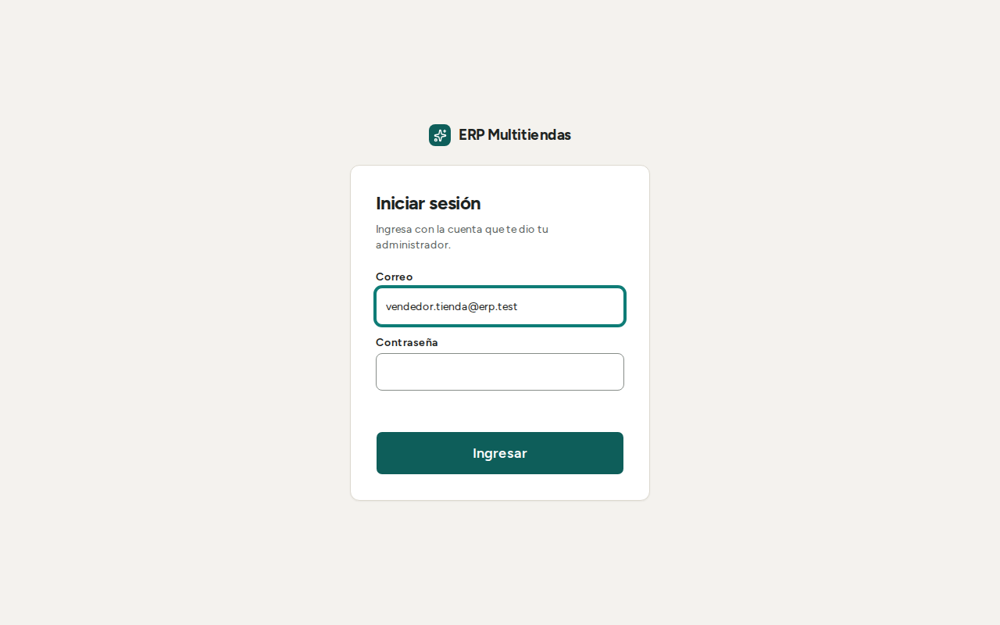

Cada persona tiene una sola cuenta y la contraseña inicial se la entrega el dueño en persona. Nadie puede crearse una cuenta
solo: el registro público está cerrado.

Para cambiar su propia contraseña, pulse "Cambiar contraseña" (junto a "Cerrar sesión"), escriba la "Contraseña actual", la
"Contraseña nueva" (8 o más caracteres, con letras y números) y "Repite la contraseña nueva". Hace falta conexión. Si alguien
olvida la suya, el dueño la restablece (sección 17).

## 2. Negocio activo

Una misma persona puede tener un rol distinto en cada negocio, por ejemplo encargado en la tienda y dueño en el frial. El
panel muestra solo los datos del negocio elegido. Para cambiar de negocio, usar el selector "Negocio activo".

Todo lo que se hace en el panel (productos, precios, inventario, reportes) vale solo para el negocio activo. Antes de cargar
algo, mirar cuál es el negocio activo.

Para salir, pulsar "Cerrar sesión". Hace falta conexión a internet. Al lado está "Cambiar contraseña" (sección 1).

## 3. Inicio

El Inicio es un tablero: muestra de un vistazo cómo va el día del negocio y qué falta atender. Arriba están la fecha de hoy,
el nombre del negocio y su rol. Cada persona ve solo los bloques que su rol puede usar (ver "Qué ve cada persona", abajo).

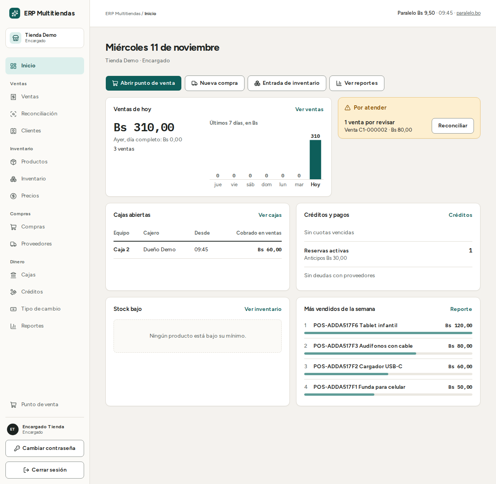

Los bloques, de arriba hacia abajo:

- **Acciones frecuentes.** Botones para lo que más se hace: "Abrir punto de venta", "Nueva compra", "Entrada de inventario" y
  "Ver reportes". Cada uno aparece solo si su rol puede hacer eso.
- **"Ventas de hoy".** El total vendido hoy, "Ayer, día completo" para comparar, la cantidad de ventas y un gráfico de los
  últimos 7 días (el día de hoy es la barra marcada "Hoy"). "Utilidad de hoy" aparece solo para quien ve costos, y solo si el
  sistema conoce el costo de lo vendido. "Ver ventas" lleva a "Ventas".
- **"Por atender".** Lo que espera una decisión suya. Cada aviso tiene una línea de detalle y un botón que lleva a resolverlo:
  - "N ventas por revisar" o "N movimientos de caja por revisar" (botones "Reconciliar" y "Revisar"; ver "Reconciliación",
    sección 10);
  - "N lotes vencen en 7 días o menos" en el frial (botón "Ver lotes"; ver "Vencimientos", sección 7);
  - "N órdenes sin recoger" en la lavandería, las listas hace más de 30 días (botón "Ver órdenes").

  Si hay más de uno del mismo tipo, la línea de detalle muestra el primero y agrega "y N más".

  Si no hay nada, dice "Nada por atender". Si el sistema no puede comprobar algo, lo dice ("No se pudo comprobar…") y el
  botón "Abrir" lleva a esa pantalla para mirarlo ahí. Cuando hay algo por atender, el bloque se ve en color ámbar.
- **"Cajas abiertas".** Las cajas que están abiertas ahora: "Equipo", "Cajero", "Desde" (la hora de apertura) y "Cobrado en
  ventas". Si no hay ninguna, dice "No hay cajas abiertas ahora." "Ver cajas" lleva a "Cajas".
- **"Créditos y pagos".** "Cuotas vencidas" (cuántos créditos y clientes, y cuánto suman; el monto sale en rojo),
  "Reservas activas" (cuántas, con el total de anticipos) y "Por pagar a proveedores" (cuánto se debe y a cuántos proveedores).
  Cada línea dice "Sin cuotas vencidas", "Sin reservas activas" o "Sin deudas con proveedores" cuando no hay nada. En la lavandería no hay créditos ni reservas: el bloque
  se llama "Pagos a proveedores".
- **"Stock bajo".** Los productos que tienen menos que su mínimo: "Producto", "Hay" y "Mínimo". Si ninguno lo está, dice
  "Ningún producto está bajo su mínimo."
- **"Más vendidos de la semana".** Los 5 productos que más se vendieron en los últimos 7 días. Si no hubo ventas, dice "Sin ventas
  en los últimos 7 días." No aparece en la lavandería.
- **"Lotes por vencer"** (solo el frial). Los lotes que vencen en los próximos 7 días, con su producto y su fecha. Un lote ya
  vencido sale en rojo.
- **"Órdenes listas"** (solo la lavandería). "Listas para recoger" (ropa terminada que el cliente aún no retira) y "Sin
  recoger hace más de 30 días" ("Conviene avisar al cliente"; si hay alguna, el número sale en rojo).

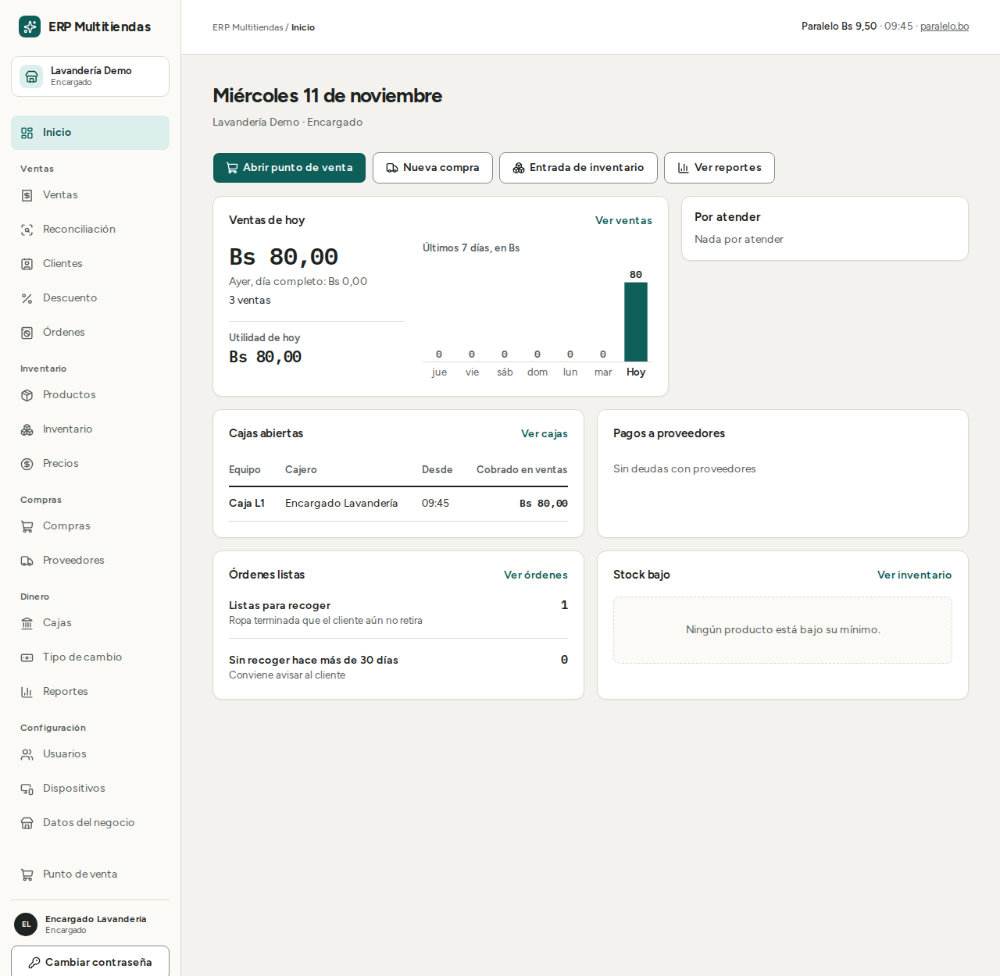

Un bloque que no puede cargarse muestra su propio aviso de error y no impide ver los demás.

### El menú lateral

A la izquierda están las pantallas, en cinco grupos. "Inicio" va suelto, arriba de todos. Si no ve una pantalla, es porque su
rol no tiene el permiso. En el celular el menú se abre con el botón de menú (tres rayas).

| Grupo | Pantallas |
|---|---|
| Ventas | "Ventas", "Reconciliación", "Clientes", "Descuento" y, en lavandería, "Órdenes" |
| Inventario | "Productos", "Inventario", "Precios" |
| Compras | "Compras", "Proveedores" |
| Dinero | "Cajas", "Créditos" (tienda y frial), "Tipo de cambio", "Reportes" |
| Configuración | "Usuarios", "Dispositivos", "Datos del negocio" |

Más abajo del menú están "Punto de venta", "Cambiar contraseña" y "Cerrar sesión".

### Qué ve cada persona

| Pantalla | Dueño | Encargado | Contador |
|---|---|---|---|
| Productos, Precios, Tipo de cambio | Sí | Sí | Solo ve "Productos", sin editar |
| Inventario | Sí | Sí | Solo ve |
| Ventas: ver el detalle | Sí | Sí | Sí |
| Ventas: anular y devolver (no aplica a ventas a crédito ni de reserva) | Sí | Sí | No |
| Reconciliación, Cajas, Reportes | Sí | Sí | Sí |
| Costos y ganancia | Sí | Sí | Sí |
| Clientes | Sí | Sí | No |
| Proveedores y Compras (incluye anular una compra o el último pago) | Sí | Sí | No |
| Créditos (tienda y frial) | Sí | Sí | Solo ve |
| Órdenes (lavandería) | Sí | Sí | Solo ve |
| Usuarios, Dispositivos, Descuento, Datos del negocio | Sí | Solo en lavandería | No |
| Gestionar a los encargados (crear, cambiar rol, quitar, desactivar, restablecer contraseña) | Sí | No | No |

En lavandería el encargado ve "Usuarios" y gestiona al resto del personal, pero no a otros encargados: eso es solo del
dueño. El vendedor y el empleado no entran al panel: trabajan en el punto de venta.

## 4. Productos

Para ver el catálogo: "Productos". Se busca escribiendo o escaneando un código de barras; la búsqueda no distingue tildes ("cafe" encuentra "café"). Los filtros son "Categoría", "Marca",
"Sin precio" e "Incluir inactivos". "Quitar filtros" los limpia. Un producto sin precio en alguna lista lleva una etiqueta ámbar ("Sin precio").

### Crear un producto

1. Pulsar "Nuevo producto".
2. Llenar "Código", "Código de barras" (opcional), "Nombre", "Marca", "Modelo", "Categoría" (o "Sin categoría"), "Tipo" y
   "Unidad" ("Unidad" o "Kilogramo").
3. "Stock mínimo": cuando el stock baje de ese número, el producto sale en la lista de stock bajo. Si lo deja vacío, no avisa.
4. "Garantía (meses)": número entero. Sale impresa en la nota de venta.
5. Marcar "Controla número de serie" solo si cada unidad lleva su serie (por ejemplo, equipos). Bajo ese campo, la pantalla explica: "Al vender, dar salida o trasladar, se elige el número de serie de cada unidad."
6. En el frial, un producto por "Unidad" tiene el campo "Peso del paquete (kg)", para paquetes de peso fijo.
7. Pulsar "Crear producto".

Los precios no se cargan aquí: se cargan en "Precios" (sección 5).

Reglas del producto:

- El "Código" y el "Código de barras" no se repiten dentro del negocio. Los 597 productos de Lider conservan los códigos "1"
  a "597" como código interno. Esto es lo que se supone por ahora; el cliente debe confirmarlo.
- Una variante (otro color, otra talla) es otro producto, con su código y su stock.
- Un producto que ya tiene movimientos no cambia de tipo ni de unidad, ni se le quita el control de serie. Activar el control
  de serie en un producto que ya tiene stock sin series tampoco se puede.
- Un producto con movimientos no se borra: se desactiva. En su ficha, pulsar "Desactivar producto" y confirmar con
  "Desactivar". Deja de ofrecerse en la venta; su historial y su stock se conservan. Si todavía tiene stock, se puede
  seguir sacando (salida o ajuste), trasladando y contando: aparece en esas pantallas marcado "(inactivo)". Para volver a
  ofrecerlo, "Reactivar producto".
- En el frial, si cambia el peso de un paquete, los kilos de las ventas pasadas se calculan con el peso nuevo. Si el paquete
  es otro, crear otro producto.
- Qué productos llevan número de serie se decide con el cliente (por ahora, solo los equipos grandes) y se marca aquí. La
  importación no activa series.

### Fotos

En la ficha del producto, "Elegir foto" (o "Cambiar foto"). Se admiten JPG, PNG o WebP. No se admite SVG. La foto se achica
sola antes de subir (a un máximo de 1.200 píxeles de lado), así que una foto del celular no hace falta reducirla antes. Si la
foto no se puede achicar, se sube tal cual y rige el límite de 5 MB.

### Categorías

Pulsar "Categorías". Escribir el "Nombre de la categoría" y pulsar "Crear categoría". Una categoría no se puede borrar, solo
renombrar: pulsar "Renombrar".

## 5. Precios y moneda

La pantalla "Precios" es una grilla con todos los productos: una fila por producto, una columna por lista de precios.
Se muestran 50 productos por página.

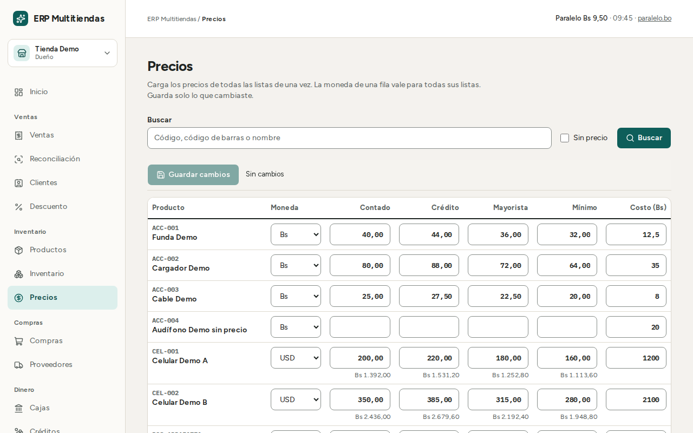

1. Buscar el producto, o marcar "Sin precio" para ver solo los que faltan.
2. Elegir la "Moneda" de la fila: "Bs" o "USD". La moneda de una fila vale para todas sus listas.
3. Escribir el precio en cada lista.
4. Pulsar "Guardar cambios". Un precio admite hasta 2 decimales; si alguno tiene más, aparece "Hay montos inválidos. No se
   guardó nada." y la pantalla no señala cuál es la fila: revise las que cambió. Se guarda solo lo que usted cambió, y la fila cambiada muestra "Modificada". Después aparece
   "Siguiente" para pasar a la página que sigue; si cambió algo, guardar antes de pasar.

Listas de precios:

- Tienda y frial: "Contado", "Crédito", "Mayorista" y "Mínimo".
- Lavandería: "Normal" y "Express".

El precio "Mínimo" es el piso: hasta ese precio el vendedor puede negociar sin permiso. Por debajo del mínimo hace falta el
permiso de descuento, y el descuento cuenta para el tope (sección 17).

Reglas importantes:

- Un producto sin precio en la lista elegida no se puede vender. Mientras la grilla no tenga precios, el punto de venta
  rechaza el producto con el mensaje "Un producto del carrito ya no tiene precio en esa lista (contado o crédito)."
- En una fila, los precios van todos en Bs o todos en USD.
- Con precio en USD, el precio en Bs se calcula con el tipo de cambio vigente y se redondea a 2 decimales (esta regla de
  redondeo se supone por ahora; a confirmar con el cliente). Si no hay tipo de cambio, la fila dice "Falta tipo de cambio" y
  el producto queda sin precio en Bs.
- El cliente cobra siempre en Bs. El dólar solo sirve para fijar precios; no se cobra en dólares. Es lo que se supone por
  ahora, a confirmar con el cliente.
- La columna "Costo (Bs)" aparece solo para quien puede ver costos y ajustar inventario. Si un producto tiene costos distintos
  por ubicación, la grilla muestra "Varía"; escribir un costo nuevo los reemplaza a todos. Los servicios no tienen costo.

## 6. Tipo de cambio y dólar paralelo

Pulsar "Tipo de cambio". La pantalla muestra el valor "Vigente", el "Historial" (últimos 20 registros) y el formulario
"Registrar nuevo".

Para registrar un tipo de cambio:

1. Escribir el valor en "Tipo de cambio nuevo" (bolivianos por 1 USD, por ejemplo 6,96).
2. Pulsar "Registrar".
3. Si el valor se aleja más de 20 % del vigente, el sistema pide confirmación con el texto "¿Registrar Bs … por 1 USD?".
   Revisar que no sea un error de tipeo y confirmar con "Registrar".

Rige siempre el tipo de cambio más reciente. Al registrar uno nuevo cambia el precio en Bs de todos los productos con precio en
USD, sin tocarlos uno por uno. Las ventas ya hechas no cambian: guardan el tipo de cambio y el precio que vio el vendedor.

### Dólar paralelo (solo referencia)

Junto al formulario aparece una tarjeta con el dólar paralelo, en el formato "Paralelo Bs …", la hora de lectura y la fuente
"paralelo.bo". Es solo una referencia:

- Si la lectura tiene más de 15 minutos, agrega "(desactualizado)".
- Si no se pudo leer, dice "Paralelo: sin datos".
- "Usar este valor" copia el número al campo del tipo de cambio, pero no lo guarda. Hay que pulsar "Registrar".
- Nunca cambia por sí solo el tipo de cambio vigente ni las ventas.

La fuente (paralelo.bo) es un sitio externo, sin garantía de que esté disponible.

## 7. Inventario

"Inventario" muestra el stock de cada producto por ubicación (tienda, depósito). Por ahora se supone que Eterazama y Sacaba cuentan como un solo depósito; está por confirmar con el cliente. Se busca con "Buscar en el inventario" (sin distinguir tildes); el
filtro "Stock bajo" muestra los que están por debajo de su mínimo. Entrar a un producto abre su kardex.

El stock siempre coincide con la suma de los movimientos del kardex. El kardex no se edita ni se borra: un error se corrige
con otro movimiento que lo compense.

### Entrada de mercadería

1. "Inventario", "Entrada".
2. Buscar el producto escribiendo o escaneando ("Código, código de barras o nombre").
3. Elegir la "Ubicación" y escribir la "Cantidad".
4. "Costo unitario en Bs (opcional)": si lo llena, el costo promedio del producto se recalcula. Si lo deja vacío, el costo
   promedio no cambia. Un producto sin costo cargado no suma ganancia en los reportes.
5. En el frial: "Lote (opcional)" y "Vence (opcional)". Si llena uno, llene también el otro. El lote lleva hasta 40
   caracteres y el vencimiento no puede ser una fecha pasada.
6. "Motivo (opcional)" y pulsar "Registrar entrada".

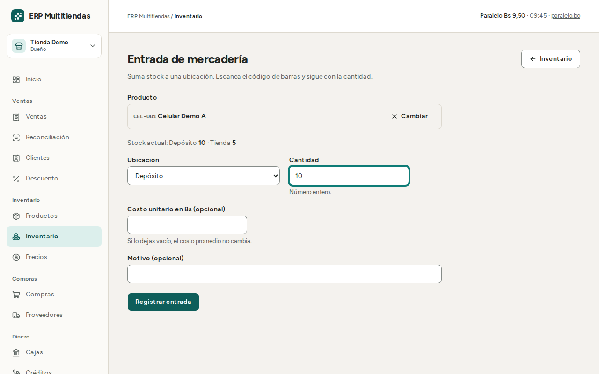

Sobre los lotes del frial: el saldo de un lote es una estimación (el más viejo sale primero), no se descuenta en cada venta,
porque el cajero no elige el lote al vender. Una entrada sin lote desplaza a los lotes viejos en esa cuenta. Una entrada ya
registrada sin lote no admite lote después.

Los productos con número de serie no cargan las series en la entrada: se cargan aparte, desde el kardex del producto con
"Registrar series" (una serie por línea; no pueden superar el stock de la ubicación).

### Salida o ajuste

Sirve para sacar stock que no es una venta, o para corregir una diferencia.

1. "Inventario", "Salida o ajuste".
2. Elegir el "Tipo": "Ajuste (con signo)", "Dañado", "Merma", "Cambio por garantía" o "Devolución a proveedor". ("Merma" es
   para el frial.)
3. Buscar el producto, elegir la ubicación y escribir la "Cantidad". En el "Ajuste (con signo)", −2 resta y +2 suma.
4. Escribir el "Motivo". Es obligatorio y queda en el kardex.
5. Pulsar "Registrar".

Esta operación necesita el permiso de ajustar inventario (dueño y encargado). Si el producto lleva número de serie, hay que elegir las series que salen, en igual cantidad. Un producto desactivado que aún
tiene stock también se puede sacar; en la lista se marca "(inactivo)". La "Merma" es solo del frial y se anota en kilos. Los productos por unidad aceptan cantidades
enteras; los de kilo, hasta 3 decimales con coma.

### Consumo de insumos (lavandería)

Los insumos (detergente, bolsas, ganchos) son productos de la lavandería con su stock. Se compran con una compra o se cargan
con una entrada. Para registrar lo que se gastó:

1. "Inventario", "Consumo". Se abre "Salida o ajuste" con el tipo "Consumo de insumo".
2. Elegir el "Insumo", la ubicación y la "Cantidad".
3. Escribir el "Motivo" y pulsar "Registrar".

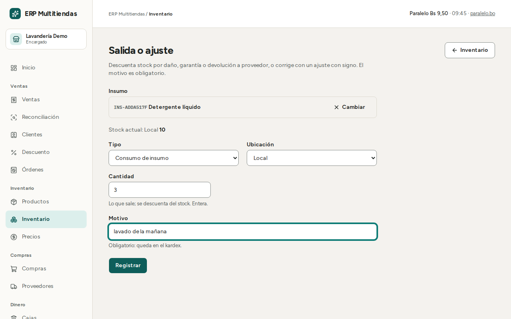

El consumo puede dejar el stock del insumo en negativo, como una venta. Si se cargó un consumo por error, entrar al kardex del insumo y pulsar "Revertir" en esa línea. Escribir el "Motivo de la
reversión" y pulsar "Revertir consumo". Se agrega un movimiento que devuelve la cantidad al stock; el consumo original queda
en el kardex.

Por ahora solo el dueño y el encargado registran consumo; el empleado de lavandería no. Es un supuesto, a confirmar con el
cliente: si quiere que el empleado también lo haga, se cambia el permiso.

### Traslado

1. "Inventario", "Traslado".
2. Buscar el producto, elegir "Origen" y "Destino", y escribir la cantidad.
3. Pulsar "Registrar traslado".

El total del producto no cambia. Un producto desactivado con stock también se puede trasladar. Si el origen no tiene stock suficiente, la pantalla avisa con "El traslado supera el stock del
origen" y ofrece "Trasladar igual".

### Conteo físico

1. "Inventario", "Conteo".
2. Elegir la "Ubicación a contar".
3. Buscar productos y escribir lo contado. Entero, o con coma si es kilo. Los productos que no cuente no se tocan; un conteo
   admite hasta 500 productos. Un producto desactivado con stock también se cuenta ("(inactivo)").
4. Pulsar "Revisar diferencias". La pantalla "Revisión del conteo" lista las diferencias ("Faltan" y "Sobran").
5. Escribir un "Motivo (opcional)" (si lo deja vacío queda "Conteo de inventario") y pulsar "Confirmar conteo". Para corregir,
   "Volver a contar".

Cada producto muestra "Sistema: N", por ejemplo "Sistema: 10 (3 reservadas)". Ese N ya incluye lo reservado: la mercadería
reservada sigue en el estante, así que usted cuenta todo lo que ve, reservado o no. Con "Sistema: 10 (3 reservadas)", si
cuenta 10 no hay diferencia; si cuenta 9, la diferencia es de 1 menos. Si cuenta menos de lo reservado (por ejemplo 2 con 3
reservadas), el stock queda en negativo y aparece en "Reconciliación": revise esas reservas.

Las diferencias quedan registradas como ajustes en el kardex. Si cambia el stock de un producto ya importado, hágalo con un
ajuste o un conteo, no volviendo a importar.

Antes de arrancar, el cliente repite el conteo físico inicial; si no, el punto de partida es el stock importado. Esto está por
confirmar con el cliente.

### Kardex de un producto

Entrar al producto desde "Inventario". El kardex es de solo lectura. Muestra "Fecha", "Movimiento", "Ubicación", "Cantidad",
"Usuario" y "Motivo y referencia". La referencia es el documento que originó el movimiento, y sale como "Ref.: Venta
C1-000012" o "Ref.: Compra del 10/11/2026". Se puede filtrar por "Ubicación" y bajar a Excel con "Descargar Excel" (hasta 5.000
movimientos).

### Vencimientos (frial)

"Inventario", "Vencimientos". Lista los lotes que vencen en los próximos 7, 15 o 30 días ("Plazo"), incluidos los que ya
vencieron. Las columnas son "Producto", "Lote", "Entró en", "Vence", "Días" y "Saldo estimado". Recordar que el saldo es una
estimación.

### Stock negativo

El sistema deja vender con stock en 0 o insuficiente, porque el mostrador no debe frenarse. El producto queda con stock
negativo y aparece en "Reconciliación" para que usted lo revise y lo corrija con un ajuste o un conteo.

## 8. Ventas: ver, anular y devolver

"Ventas" lista las ventas del negocio, de la más reciente a la más antigua. Se filtra por "Número" (por ejemplo C1-000123),
"Estado" ("Completada" o "Anulada"), "Equipo", "Desde" y "Hasta". Entrar a una venta muestra su detalle: líneas, pagos y
devoluciones.

En la lista, el estado de cada venta sale como una etiqueta de color ("Completada" en verde, "Anulada" en rojo). Una venta a crédito sale marcada "Crédito" y una venta que completó una reserva, "Reserva". En su detalle no hay
"Anular venta" ni "Devolver": aparece una explicación (la inicial, las cuotas o el anticipo ya quedaron registrados) y, en
las de crédito, el enlace "Ver pagos del crédito" (si su rol ve "Créditos").

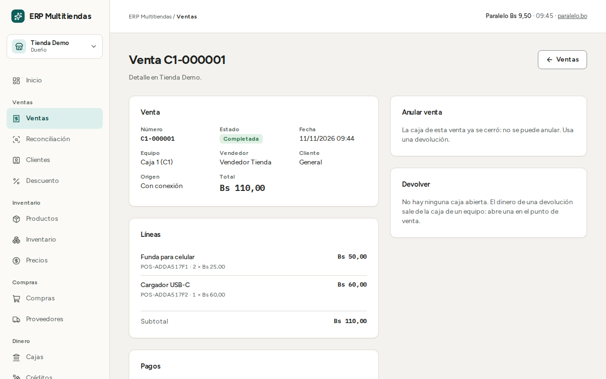

Quien vende en el punto de venta (vendedor o empleado) no anula ni devuelve, ni siquiera dentro de las primeras 24 horas. Si
hace falta, lo hace usted o el encargado. Un cambio de esto exige crear un permiso aparte.

### Anular una venta

La anulación borra el efecto de la venta completa: devuelve el stock, quita la venta del efectivo esperado de su caja y deja la
venta marcada como "Anulada" (no se elimina).

1. "Ventas", entrar a la venta.
2. Pulsar "Anular venta".
3. Escribir el "Motivo de la anulación" (hasta 200 caracteres).
4. Confirmar en "¿Anular la venta …?". No se puede deshacer.

Reglas:

- Necesita conexión a internet.
- Solo se puede anular si la caja de esa venta sigue abierta. Con la caja cerrada, la pantalla dice "La caja de esta venta ya
  se cerró: no se puede anular. Usa una devolución."
- No se puede anular una venta que ya tiene devoluciones. Se devuelve lo que falta.
- Pasadas 24 horas de la venta, anular o devolver exige además el permiso de devolución fuera de plazo (dueño y encargado).
- Una venta a crédito y una venta que completó una reserva no se anulan ni se devuelven desde el sistema. El dinero repartido
  en cuotas o aplicado a la reserva no tiene reverso automático. Hable con el dueño antes de aceptar un reclamo de esa clase.
  Lo que sí se revierte es el último pago de una cuota (sección 15). Una venta a crédito o de reserva hecha por error no
  tiene reverso: por eso el punto de venta pide revisar bien antes de cobrar.
- Una venta que es una orden de lavandería se anula desde la orden (sección 16).

### Devolver una venta

Se usa cuando la caja de la venta ya cerró, cuando hay que devolver solo una parte, o cuando pasó un tiempo.

1. "Ventas", entrar a la venta y pulsar "Devolver".
2. En "Líneas a devolver", escribir la cantidad de cada línea que se devuelve.
3. En "Caja que devuelve", elegir la caja abierta de la que sale el dinero.
4. En "Medio preferido", elegir "Efectivo" o "QR". El sistema reparte según lo cobrado: lo pagado por QR vuelve por QR.
5. Escribir el "Motivo de la devolución" y pulsar "Devolver". No pide una segunda confirmación: al pulsar, la devolución
   se registra. Revise las cantidades antes.

Reglas:

- Hace falta una caja abierta en algún equipo: el dinero sale de ahí. Si no hay ninguna, la pantalla lo dice.
- La devolución puede ser parcial. Nunca puede superar lo vendido menos lo ya devuelto.
- Una venta anulada no admite devolución.
- Una devolución en efectivo sale del cajón. Si la caja no tiene efectivo, hay que reponerlo con un ingreso o usar otra caja.
- El stock vuelve por el kardex.
- Una venta pagada por QR devuelta no saca efectivo del cajón. Si el QR de la venta fue rechazado, solo se devuelve lo que se
  cobró de verdad.

### Descartar una venta rechazada

Si el punto de venta avisa "N operaciones rechazadas al enviar" (o "1 operación rechazada al enviar"), el cliente ya pagó y descartar no se deshace. El vendedor debe
llamarlo a usted. Descartar exige el permiso de devolución fuera de plazo (dueño y encargado) y una confirmación escrita: hay que escribir
DESCARTAR. Quien no tiene ese permiso ve "Para descartar una operación rechazada avisa al encargado." Cada fila tiene
"Reintentar" y "Descartar". Pasados 30 días del cierre de la caja de esa venta, solo se puede descartar.

### Reservas y créditos

Las reservas con anticipo y las ventas a crédito se hacen en el punto de venta (solo tienda y frial). Reservas: pueden
crearlas el dueño, el encargado y el vendedor, pero necesitan conexión. Cancelar una reserva libera el stock y devuelve el
anticipo por la caja de quien la cancela, por el mismo medio y monto. Cancelar exige además el permiso de anular: el
vendedor ve "Para cancelar la reserva, pide a un encargado." y la cancela usted. Que el anticipo se devuelva así es lo que se supone por
ahora; a confirmar con el cliente.

## 9. Cajas y arqueos

"Cajas" lista las sesiones de caja, de la más reciente a la más antigua. Entrar a una sesión muestra:

- "Apertura" y "Cierre" (quién y cuándo).
- "Arqueo": "Efectivo inicial", "Ventas en efectivo", "Ingresos", "Gastos", "Retiros", "Devoluciones en efectivo", y, si hay,
  "Anticipos de reservas en efectivo" y "Cuotas de crédito en efectivo".
- "Esperado" (en una caja cerrada, "Esperado al cierre"), "Contado" y "Diferencia".
- "QR (cobrado menos devuelto)".
- "Movimientos" y "Ventas de la sesión" (se muestran las 200 más recientes con el aviso "Mostrando N de M"; los totales
  no salen de esa lista cortada).

Cómo leerla:

- "Esperado" (o "Esperado al cierre", en una caja cerrada) es el efectivo que debería haber: lo inicial, más las ventas en efectivo, los ingresos, los anticipos de reserva
  y las cuotas de crédito cobradas en efectivo, menos los gastos, los retiros y las devoluciones en efectivo. Una venta
  anulada sale del esperado.
- "Contado" y "Diferencia" aparecen cuando el cajero cierra la caja. El cajero hace un arqueo ciego: no ve el esperado
  mientras la caja está abierta. En el panel, el esperado de una caja abierta es el de ese momento.
- La diferencia sale como "Sin diferencia", "Sobrante" o "Faltante". En la lista de cajas, la diferencia sale en rojo si falta dinero y en ámbar si sobra.
- Ver el esperado y el desglose exige poder ver reportes (dueño, encargado y contador).
- Cerrar la caja es definitivo: no se edita.

Si la caja de un equipo se cerró y después llegan ventas hechas sin conexión en ese horario (hasta 30 días después), se
aceptan y quedan marcadas con "Enviada después de que se cerró la caja". Usted puede anularlas sin el plazo de 24 horas;
anularlas no mueve efectivo. Fuera de ese rango se rechazan. En el detalle de esa caja el arqueo del cierre no cambia: aparece
un aviso ("Después del cierre llegaron...") y una línea aparte, "Esperado con lo que llegó después", que suma lo que llegó
tarde. "Esperado al cierre", "Contado" y "Diferencia" siguen siendo los del cierre.

"Cuotas de crédito en efectivo" puede salir en negativo. Pasa cuando se anuló un pago de cuota (sección 15) y el efectivo
se devolvió desde esa caja: el reverso resta, y esa caja no necesariamente es la que cobró la cuota.

Un equipo puede cerrar su caja aunque tenga ventas o movimientos rechazados: no bloquean el cierre. El cajero ve "Hay N
operaciones rechazadas sin resolver" y las rechazadas de cajas anteriores se avisan aparte. El esperado no cuenta esas
ventas, pero el cliente ya pagó: el efectivo cobrado aparece como diferencia en el cierre hasta que usted las reintente o
las descarte (sección 8). Lo que sí bloquea el cierre son las operaciones sin enviar, una apertura de caja rechazada y los
cobros sin confirmar de ese equipo.

Los gastos y retiros mayores al efectivo de la caja se rechazan cuando se hacen con conexión. Si se hicieron sin conexión se
aceptan y quedan para revisar, porque el dinero ya salió.

Los pagos a proveedor no pasan por la caja del punto de venta. Si se pagó con plata del cajón, pida al cajero registrar
además un "Gasto" de caja.

## 10. Reconciliación (ventas sin conexión)

El punto de venta sigue vendiendo aunque se corte internet. Esas ventas se envían solas al volver la conexión. Con ellas,
"Reconciliación" le muestra lo que hay que mirar. Hace falta poder ver reportes.

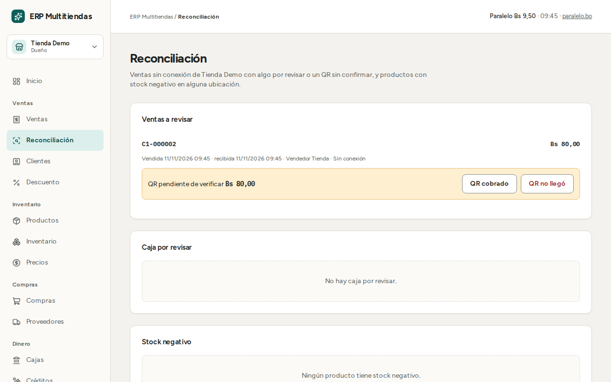

La pantalla tiene tres bloques:

**Ventas a revisar.** Cada venta dice "Sin conexión" y el motivo de revisión. Los motivos son:

- "Producto inactivo al enviarse"
- "Producto sin precio de lista"
- "Descuento sin permiso de quien vendió"
- "Descuento sobre el tope"
- "Número cambiado al enviarse"
- "Enviada desde otra cuenta"
- "Sin cliente registrado"
- "Enviada después de que se cerró la caja"

Sin conexión el sistema no puede verificar el precio ni el descuento. Acepta la venta y la deja marcada, porque el dinero ya se
cobró. Para cerrar un caso, revíselo y pulse "Marcar revisada". Quien tiene cuenta de vendedor y conocimientos técnicos
podría aprovechar esto para enviar ventas "sin conexión" por debajo del piso de precio o por encima del tope de descuento.
No se puede impedir, pero queda marcado aquí: por eso conviene revisar esta pantalla seguido.

**QR pendiente.** Una venta sin conexión pagada por QR queda "pendiente de verificar". Mire su cuenta del banco:

- Si el dinero llegó, pulse "QR cobrado".
- Si no llegó, pulse "QR no llegó" y confirme. Ese pago se marca como rechazado y deja de contar en el QR de la caja. La
  venta sigue completada: anúlela o devuélvala si corresponde.

Un QR confirmado en el mostrador (venta con conexión, anticipo de reserva o cuota de crédito) no se puede marcar como
rechazado después. Verifique el QR en el celular antes de que el cajero lo confirme.

**Caja por revisar.** Movimientos de caja aceptados con una marca (por ejemplo, hechos por alguien sin permiso de caja, con
hora de más de 30 días atrás, o por encima del efectivo disponible). Revise y pulse "Marcar revisado".

**Stock negativo.** Lista los productos con stock negativo por ubicación. Corrija con un ajuste o un conteo. "Ver todo en
Inventario" abre el inventario completo.

Cosas a saber:

- Si cambia el número de una nota al enviarse, la nota impresa conserva su número original y el sistema guarda ambos.
- Cada equipo solo ve sus propias ventas pendientes.
- Un equipo sin conexión deja de vender a las 72 horas sin hablar con el servidor, hasta que se conecte e inicie sesión. Las
  ventas pendientes no se pierden.
- Si el navegador de un equipo borra sus datos, se pierden las ventas sin enviar. Antes de limpiar un equipo, cierre la caja y
  verifique que no quede el aviso de ventas sin enviar.

## 11. Reportes

"Reportes" necesita poder ver reportes. Elegir el reporte, las fechas "Desde" y "Hasta" (atajos: "Este mes", "Mes anterior"),
pulsar "Aplicar" y, para guardar los datos, "Descargar Excel". Bajo los reportes aparece un texto que dice qué cuenta ese
reporte y por qué día (la regla de "Reglas", abajo).

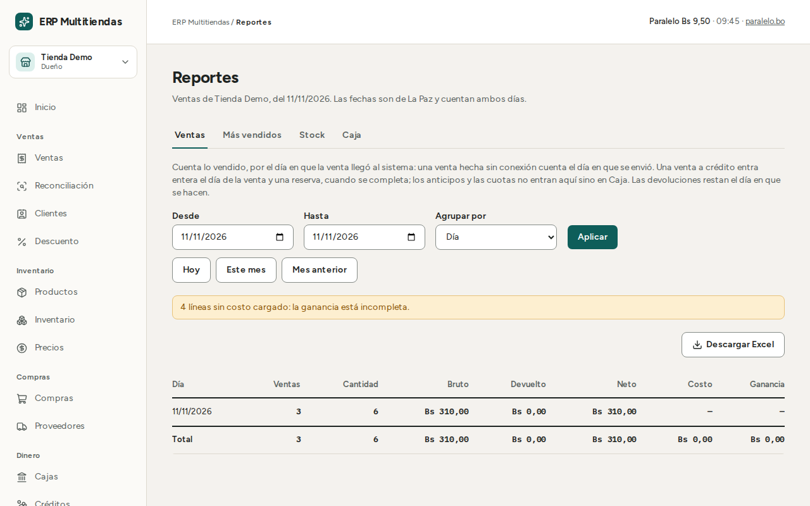

Reportes de cada negocio:

- Tienda: "Ventas" (por día, vendedor, producto, categoría o marca, con "Agrupar por"), "Más vendidos", "Stock" y "Caja".
- Frial: "Ventas" (por día o por "Corte", con kilos), "Stock" y "Caja". Los lotes por vencer están en el botón
  "Vencimientos".
- Lavandería: "Ingresos" (por día o "Servicio", con kilos), "Insumos" y "Caja".

Reglas:

- El rango máximo es de 366 días y 5.000 filas. Si lo supera, el sistema pide dividir el reporte.
- Ventas cuenta lo vendido; Caja cuenta lo cobrado. En "Ventas", una venta a crédito entra entera el día de la venta y una
  reserva entra cuando se completa; los anticipos, las cuotas y el interés no entran ahí: están en "Caja". Por eso los dos
  reportes no tienen por qué dar lo mismo.
- La fecha de una venta es el día en que llegó al servidor (hora de La Paz): una venta hecha sin conexión cuenta el día en que
  se envió. Una devolución resta en su propia fecha. En "Caja" cada caja cuenta por el día en que se abrió, y una venta sin
  conexión cuenta en la caja donde se hizo, aunque llegue después.
- En lavandería, "Ingresos" cuenta las órdenes recibidas (la orden se cobra al recibirla; una orden anulada no cuenta) y
  "Caja" cuenta el efectivo y el QR de las órdenes. Los textos de pantalla lo dicen con esas palabras.
- Ganancia = neto menos cantidad por costo guardado al vender. Un producto sin costo cargado no suma ganancia y se cuenta
  aparte: el reporte avisa "línea sin costo cargado: la ganancia está incompleta".
- Costo, ganancia y valor del stock se ven solo con permiso de costos (dueño, encargado y contador).
- El reporte "Insumos" (gasto en insumos de la lavandería) exige poder ver reportes y ver costos a la vez. Muestra cantidad
  por costo de cada insumo y día. Un consumo sin costo no suma al gasto. Los consumos revertidos no cuentan.
- El reporte de "Stock" admite "Mostrar": "Todo", "Stock bajo" o "Sin movimiento" (con "Sin salidas hace" N días). Con más de
  5.000 productos activos pide dividir.
- Los reportes se bajan a Excel con "Descargar Excel". No hay PDF, gráficos, reportes por correo ni un resumen de los tres
  negocios juntos.
- El archivo se llama `<reporte>-<negocio>-<desde>-<hasta>.xlsx`. No lo guarde de nuevo como CSV: un texto que empiece con
  `=`, `+`, `-` o `@` podría interpretarse como fórmula en otro programa.

## 12. Clientes

"Clientes" (tienda, frial y lavandería). Los clientes son de cada negocio: un cliente de un negocio no aparece en otro.

1. Buscar por nombre o documento (sin distinguir tildes).
2. Para crear, "Nuevo cliente": "Nombre", "CI o NIT", "Teléfono", "Dirección" y "Guardar cliente".
3. Para editar, pulsar "Editar" en la fila, cambiar y "Guardar cambios".

El "CI o NIT" es único dentro del negocio. Si ya existe, el sistema avisa "Ya existe un cliente con ese documento. Búscalo y
selecciónalo." La venta por defecto va a "General". En lavandería el cliente es obligatorio. Los datos personales de los
clientes no se comparten con otros negocios.

## 13. Proveedores

"Proveedores" lista los proveedores del negocio con lo que se les debe. Los pagos a proveedor no pasan por la caja del punto de
venta.

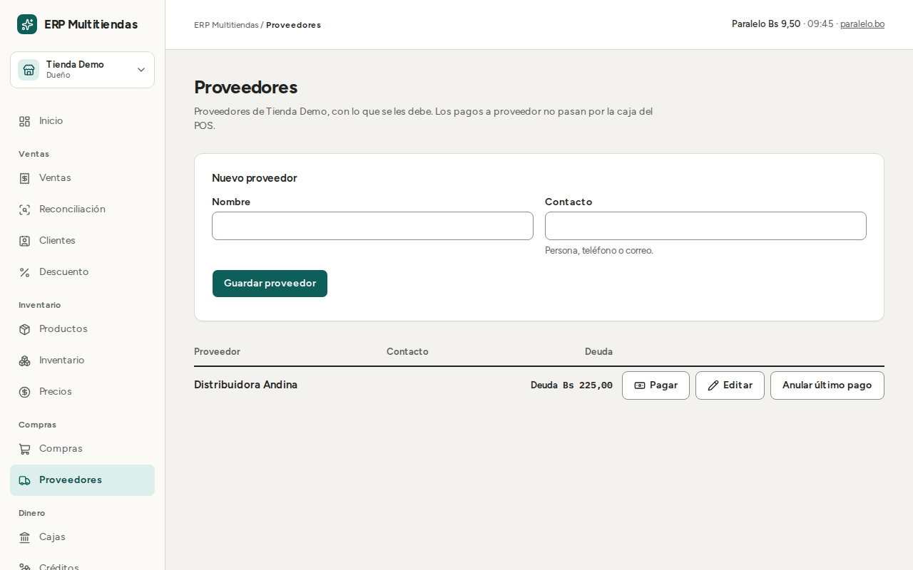

- Crear: "Nuevo proveedor", "Nombre", "Contacto" (persona, teléfono o correo), y "Guardar proveedor". El sistema no impide
  repetir nombres: revise antes de crear.
- Editar: "Editar". Para dejar de ofrecerlo en las compras, desmarcar "Activo (aparece al registrar compras)".
- Pagar: "Pagar", escribir el "Monto en Bs", elegir el "Medio" ("Efectivo", "QR" o "Transferencia") y registrar. La pantalla
  muestra "Deuda actual". Un pago no puede superar lo que se le debe al proveedor.

La deuda con un proveedor es la suma de sus compras menos la suma de sus pagos.

## 14. Compras

"Compras" lista las compras. Cada compra suma stock y recalcula el costo promedio. Hay compras en todos los negocios, también en
lavandería (por ejemplo, de insumos).

1. Pulsar "Nueva compra".
2. Elegir el "Proveedor" y la "Ubicación de entrada".
3. Elegir la "Condición": "Al contado (se paga ahora)" o "A crédito (queda deuda)".
4. Si es al contado, elegir el "Medio de pago".
5. Agregar los productos: buscar el producto, escribir "Cantidad" y "Costo unitario (Bs)". "Agregar producto" suma otra
   línea; "Quitar línea" la saca. No repita un producto: súmelo en una sola línea. En el frial, cada línea pide además el
   "Lote" (hasta 40 caracteres) y "Vence" (una fecha que no sea pasada): sin ellos no se registra. En tienda y lavandería esos
   campos no existen.
6. Pulsar "Registrar compra".

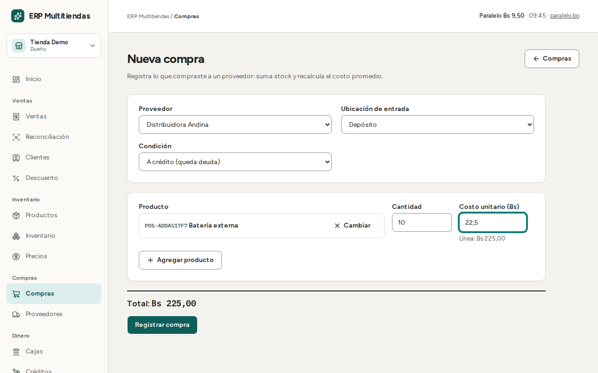

Una compra al contado registra el pago por el total en el mismo momento. Una compra a crédito sube la deuda del proveedor; se
paga después desde "Proveedores".

Los totales y costos de las compras solo se ven con permiso de costos; la deuda por proveedor la ve quien gestiona compras
(dueño y encargado).

### Anular una compra

Si una compra se registró mal, en "Compras" pulse "Anular compra" en su fila (la compra sigue en la lista, marcada "Anulada").
Necesita el permiso de anular (dueño y encargado). Escriba el "Motivo" (hasta 200 caracteres) y pulse "Anular compra" en el
diálogo. Qué pasa:

- El stock que entró se descuenta, con un movimiento propio en el kardex; la entrada original queda.
- El costo promedio de los productos se corrige. Si después de la compra hubo ventas o traslados, el nuevo costo promedio es
  una aproximación.
- Una compra al contado también revierte su pago. Una compra a crédito baja la deuda del proveedor.
- En el frial, el lote de esa compra deja de aparecer en "Vencimientos".

No se puede anular si:

- Algún producto lleva número de serie: "Una compra de productos con serie no se puede anular."
- Ya no hay stock suficiente en esa ubicación porque parte se vendió o se movió: "Ya no hay stock suficiente en la ubicación
  para deshacer la compra: parte se vendió o se movió." Registre antes lo que corresponda.
- Tiene pagos al proveedor hechos a mano, o la deuda quedaría en negativo: "La compra tiene pagos al proveedor o la deuda
  quedaría en negativo. Anula primero el último pago del proveedor."

En el frial el sistema revisa el stock total del producto, no el saldo del lote.

### Anular el último pago a un proveedor

En "Proveedores", "Anular último pago" en la fila del proveedor (necesita el permiso de anular). El diálogo muestra el monto y
la fecha del pago; escriba el "Motivo" y pulse "Anular pago". La deuda del proveedor sube ese monto; el pago no se borra, queda
con su reverso. Solo se anula el último pago: si hay uno más reciente, el sistema lo dice. El pago de una compra al contado
no se anula aquí: se revierte anulando la compra. Recuerde que los pagos a proveedor no pasan por la caja del punto de venta.

## 15. Créditos (tienda y frial)

"Créditos" muestra las cuentas por cobrar. La lavandería no tiene crédito. Las cuotas se cobran en el punto de venta, por la
caja: aquí se consulta, se cargan saldos antiguos y se fijan los parámetros.

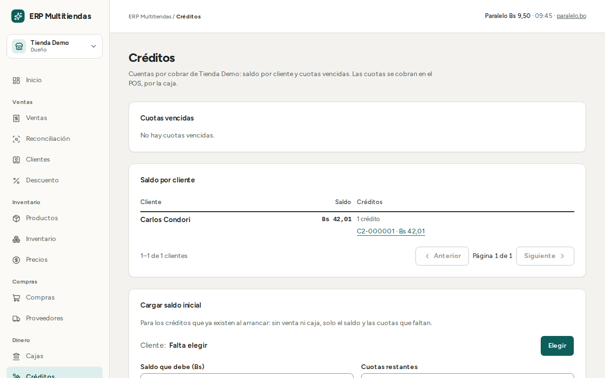

La pantalla tiene:

- "Cuotas vencidas": cada cliente con atraso, con días de atraso.
- "Saldo por cliente": cuánto debe cada cliente. Entrar al crédito muestra su detalle: "Cuotas", "Pagos" y "Saldo".
- "Cargar saldo inicial".
- "Parámetros del crédito".

### Cómo funciona un crédito

La venta a crédito se hace en el punto de venta, con conexión, con el cliente elegido y la lista "Crédito". Los parámetros por
defecto del negocio son:

- "Inicial mínima (%)": 50 %.
- "Cuotas por defecto": 3.
- "Interés mensual (%)": 2,5 %.
- "Máximo de cuotas": 12 (se puede subir hasta 36).

Reglas:

- Solo el dueño y el encargado crean un crédito, cargan un saldo inicial o cambian los parámetros. Cobrar una cuota lo hace
  quien tiene caja, es decir, el vendedor también.
- La inicial debe ser mayor a 0 y menor al total. Si queda por debajo del mínimo, el punto de venta avisa "La inicial es menor
  al mínimo del negocio. Sube la inicial."
- Las cuotas son mensuales. Vencen la fecha de la venta más 1, 2, 3… meses (si el mes es más corto, el último día del mes). Hay
  un solo interés por negocio.
- El interés vive en las cuotas: no se suma al total de la venta ni a los reportes de ventas.
- Cómo se calcula el interés es un supuesto: por ahora, sobre el saldo, con cuota fija; la última cuota absorbe la diferencia de
  redondeo. A confirmar con el cliente. Si el cliente dice que es sobre el total, solo cambia el plan de cuotas.
- Un cobro admite pago parcial. Cubre las cuotas de la más vieja a la más nueva. No se puede pagar más que el saldo: "El pago
  supera el saldo del crédito."
- Los documentos del crédito son tres casillas ("CI", "Comprobante de domicilio" y "Pagaré"); no se guardan archivos. Se
  pueden marcar o desmarcar después de vender: en el detalle del crédito, "Documentos entregados", cambiar las casillas y
  "Guardar documentos". Cada cambio queda registrado.
- El plan de cuotas se vuelve a imprimir desde el detalle del crédito, con "Imprimir plan" (hoja A4).
- No hay recibo imprimible de una cuota: el comprobante es el saldo en pantalla.
- Una venta con crédito no se anula ni se devuelve (sección 8), y una venta a crédito o de reserva hecha por error no tiene
  reverso. Lo único que se revierte es el último pago de una cuota (ver abajo).
- Si el cliente paga todo el saldo de una vez, por ahora se cobra el interés completo de todas las cuotas, también el de
  los meses que todavía no pasaron. A confirmar con el cliente.

### Anular el último pago de una cuota

Sirve para un cobro registrado por error. En el detalle del crédito, en "Anular último pago" (necesita el permiso de anular):

1. Elegir la "Caja que devuelve el efectivo": debe ser una caja abierta con efectivo suficiente. Puede ser otra distinta de la
   que cobró; si no hay ninguna abierta, la pantalla dice que hay que abrir una en el punto de venta.
2. Escribir el "Motivo de la anulación" y pulsar "Anular último pago", y luego "Anular pago".

El saldo del crédito sube ese monto y el pago queda marcado como anulado, no se borra. Solo se anula el último pago: si ya
hay otro más reciente, "Solo se puede anular el último pago del crédito. Recarga la página.". Si la caja no tiene efectivo:
"La caja elegida no tiene efectivo suficiente para devolver ese pago. Elige otra caja."

### Cargar un saldo inicial

Sirve para créditos que ya existían antes de usar el sistema.

1. En "Cargar saldo inicial", elegir el cliente.
2. Escribir el "Saldo que debe (Bs)", las "Cuotas restantes" y cuándo "Primera cuota vence".
3. Pulsar "Cargar saldo inicial".

No genera venta ni mueve la caja, y se carga sin interés: el monto es lo que se debe. Las demás cuotas vencen el mismo día de
los meses siguientes.

Para anular un saldo inicial, entrar al crédito y pulsar "Anular saldo inicial". Escribir el "Motivo de la anulación" y
confirmar. Solo se puede mientras no tenga pagos; un crédito que tuvo pagos no se anula, aunque esos pagos estén revertidos.

La forma en que el cliente entrega los saldos (carga manual, de 1 a 20 créditos) es un supuesto; a confirmar con el cliente.

### Parámetros del crédito

Cambiar los números y pulsar "Guardar parámetros". Valen para los créditos nuevos de ese negocio.

## 16. Órdenes de lavandería en el panel

En lavandería aparece "Órdenes". Lista las órdenes de la más reciente a la más antigua. Se filtra por "Número o cliente" y por
"Estado" ("Activas" o "Sin recoger (más de 30 días)"). Por número de boleta la búsqueda funciona sin más; por nombre de
cliente todavía distingue tildes, así que "Maria" no encuentra "María". La lista se pasa de página con "Siguientes": si una
orden cambia de estado mientras usted pasa de página, puede saltarse en la lista. Si falta una, vuelva a "Volver al inicio". "Sin recoger" lista las órdenes listas hace más de 30 días: es un aviso,
y qué hacer con la ropa lo decide una persona.

Entrar a una orden muestra "Estado", "Cliente", "Prendas", "Casillero", "Fecha prometida", quién la recibió, quién la retiró
(con boleta o con carnet) y su "Historial". "Ver venta" abre la venta asociada.

Reglas:

- Los estados son Recibida, En lavado, Lista para entregar y Entregada (más Cancelada). Los cambia el empleado desde el punto
  de venta, con conexión. Se puede volver un paso atrás; otros saltos se rechazan.
- Para anular una orden: entrar a la orden, "Anular orden", escribir el "Motivo de la anulación" (hasta 200 caracteres) y
  confirmar. Necesita permiso de anular (dueño y encargado).
- Si la caja de la orden sigue abierta, se devuelve el efectivo. Si ya cerró, no se toca el dinero: la pantalla dice "La caja
  de esa orden ya cerró: si corresponde, registra una devolución en Ventas."
- Una orden ya entregada no se anula: "La orden ya se entregó: registra una devolución en lugar de anular."
- El cobro es el total al recibir la ropa (efectivo, QR o mixto). No hay saldos por cobrar en lavandería. Esto es lo que se
  supone por ahora; a confirmar con el cliente. Solo se cobra en Bs.
- Una orden creada sin conexión lleva el cliente escrito a mano y queda marcada "Sin cliente registrado" en Reconciliación.
- Los precios por servicio (normal y express, por kilo o por pieza) los carga el cliente. Los valores que se supone por ahora
  (kilo de lavado, prendas, planchado, recargo express, cobro mínimo) están a confirmar con el cliente. Si una prenda se daña o
  se pierde, se anota en la nota de la orden (también a confirmar con el cliente).

## 17. Solo el dueño: usuarios, dispositivos, descuento, datos del negocio y copias de seguridad

Las pantallas de esta sección ("Usuarios", "Dispositivos", "Descuento" y "Datos del negocio") aparecen solo con el permiso
de usuarios. En tienda y frial lo tiene solo el dueño. En lavandería lo tienen el dueño y el encargado, pero a los
encargados solo los gestiona el dueño.

### Usuarios

"Usuarios" lista al personal del negocio: "Nombre", "Rol", "Estado" y "Acciones". Su propia fila dice "Tú". Los roles son
"Dueño", "Encargado", "Contador", "Vendedor" y "Empleado".

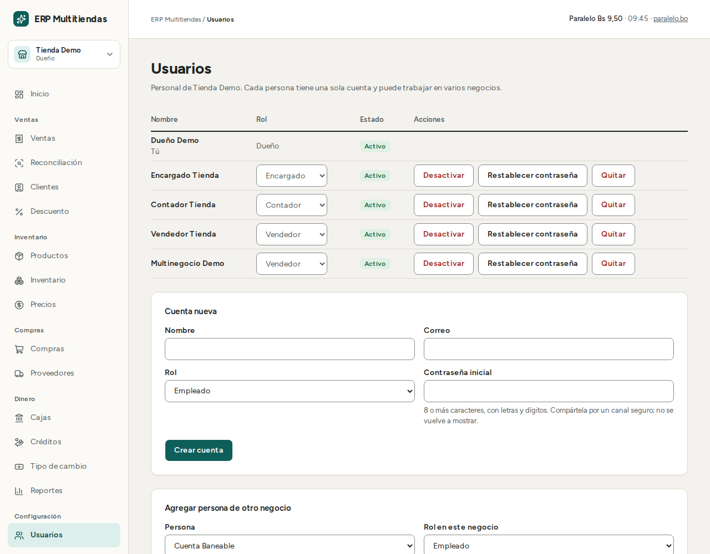

**Crear una cuenta.**
1. En "Cuenta nueva", escribir el nombre, el "Correo" y elegir el "Rol". El rol "Encargado" solo lo ofrece el dueño.
2. Escribir la "Contraseña inicial": 8 o más caracteres, con letras y dígitos.
3. Pulsar "Crear cuenta".
4. Entregar la contraseña a la persona en persona, por un canal seguro. No se vuelve a mostrar.

**Agregar una persona de otro negocio.** En "Agregar persona de otro negocio", elegir la "Persona" y el "Rol en este negocio"
y pulsar "Agregar al negocio".

**Cambiar el rol.** En la fila, usar el selector de rol y confirmar con "Cambiar rol". El cambio vale de inmediato y solo en
este negocio.

**Restablecer la contraseña.** En la fila de la persona, "Restablecer contraseña". Escribir la "Contraseña nueva" (8 o más
caracteres, con letras y números) y "Repite la contraseña", y pulsar "Restablecer contraseña". Aparece "Contraseña
restablecida. Entrégasela a la persona y pídele que la cambie al entrar." La contraseña anterior deja de servir, pero las
sesiones que la persona ya tenía abiertas no se cierran. Si sospecha que la cuenta la tiene otra persona: "Desactivar",
restablecer la contraseña y "Reactivar". La contraseña propia se cambia con "Cambiar contraseña" (sección 1).

**Desactivar o quitar.**
- "Desactivar" corta el acceso de esa persona a todos sus negocios, al instante. Sus datos se conservan; se puede "Reactivar".
- "Quitar" la saca de este negocio y conserva su cuenta y sus otros negocios. Si es su último negocio, no se puede quitar: hay
  que desactivar la cuenta.
- Un equipo sin conexión puede seguir vendiendo hasta 72 horas con una cuenta desactivada; después se bloquea.

Reglas de protección:

- Solo el dueño gestiona a los encargados y a otros dueños: darles ese rol, cambiárselo, quitarlos, desactivarlos,
  reactivarlos o restablecer su contraseña. Esto vale también en lavandería, donde el encargado gestiona al resto del
  personal pero no a otros encargados.
- No se puede dejar el negocio sin un dueño activo, ni cambiar el propio rol, ni quitarse a sí mismo.
- Los cambios de productos, precios, usuarios y permisos quedan registrados (quién, cuándo, antes y después). Por ahora no hay
  una pantalla para mirarlos.

Por ahora faltan los correos y roles del personal del cliente; se cargan aquí cuando el cliente los entregue. Las personas de la
lavandería que también trabajan en la tienda se asignan a ambos negocios; es un supuesto, a confirmar con el cliente.

### Datos del negocio

"Datos del negocio" (en el menú, grupo "Configuración") guarda lo que sale impreso en la nota de venta y en la boleta de lavandería.
Cada negocio tiene los suyos; mire cuál es el negocio activo antes de guardar.

1. Escribir el "NIT" (hasta 20 caracteres, en una sola línea).
2. Escribir los "Datos para la nota": la dirección y el teléfono, hasta 300 caracteres y 6 líneas. El teléfono no es un campo
   aparte: va dentro de este texto.
3. Pulsar "Guardar datos". Aparece "Datos guardados."

Si algo pasa de esos límites, la pantalla lo avisa y no guarda. Dejar un campo vacío es válido: esa línea sale sin él. El NIT
y el texto salen arriba de la nota, bajo el nombre del negocio. Quien tiene el permiso de usuarios los cambia (en tienda y
frial, el dueño; en lavandería, el dueño y el encargado). Cada cambio queda registrado. Las notas ya impresas no cambian.

### Dispositivos

"Dispositivos" lista las cajas y equipos del negocio. El prefijo identifica los comprobantes de cada equipo. Hoy hay una caja
por negocio: C1 en Multitienda Lider, L1 en Lider Clean y F1 en Frial Lider.

Para registrar un equipo nuevo: escribir el "Nombre", el "Prefijo" (una letra y 1 o 2 dígitos, por ejemplo C2), elegir la
"Ubicación" y pulsar "Registrar dispositivo". Un prefijo no se repite dentro del negocio. Sin equipo elegido no se vende, y cada
equipo lleva su propia numeración de notas (`PREFIJO-000123`).

### Descuento

"Descuento" fija el "Tope (%)" de descuento sobre una venta, por negocio. Escribir un porcentaje de 0 a 100 (por ejemplo 10 o
7,5) y pulsar "Guardar tope".

- El tope arranca en 0 %: con 0 % nadie descuenta. Hasta que el cliente lo defina, el mostrador no puede dar descuentos.
- El tope se mide sobre el subtotal de la venta. Un descuento mayor se rechaza con "El descuento supera el tope permitido."
- Descontar exige el permiso de descuento: dueño y encargado en tienda y frial; dueño, encargado y empleado en lavandería. El
  vendedor no descuenta. El encargado vende desde su propia sesión: no hay clave de autorización en el equipo del vendedor.

### Copias de seguridad (backup)

El sistema copia la base de datos solo, sin que nadie haga nada, dos veces al día, y guarda cada copia 30 días. Las fotos de
los productos se copian una vez por semana (los domingos) y se guardan 14 días. Las copias salen cifradas fuera de Supabase.

- **Qué se pierde en el peor caso.** Si Supabase se pierde por completo, se pierden los datos posteriores a la última copia:
  en el uso normal, hasta unas 15 horas; hasta unas 27 si el servicio que las corre se salta una corrida. De las fotos se
  pierden las subidas desde el último domingo, hasta 7 días. Con el proyecto funcionando, las fotos no se pierden.
- **La clave privada.** Las copias se cifran con una clave pública; para leerlas hace falta la clave privada (llamada `age`).
  Vive fuera del sistema, en poder del proveedor. Si se pierde, ningún backup se puede leer. Pida una copia fuera de
  línea de esa clave y guárdela en un lugar seguro y aparte.
- **Qué no cubre.** No copia nada fuera de la base y las fotos de productos, ni la configuración del proyecto en Supabase.
- La restauración la hace el proveedor del sistema, no el negocio.

### Riesgos aceptados

Dos límites del sistema que el dueño debe conocer:

- Cualquier cuenta del negocio (también la de un vendedor o la del contador) puede leer los créditos, los saldos de los
  clientes y los movimientos de caja si sabe consultar la base de datos. Los permisos ordenan lo que muestran las pantallas;
  no impiden esa lectura. Tampoco el arqueo ciego del cajero es hermético.
- Quien tiene cuenta de vendedor y conocimientos técnicos puede saltarse el piso de precio y el tope de descuento enviando
  ventas "sin conexión". Queda marcado en "Reconciliación" (sección 10).

## 18. Antes de arrancar

Pendientes del lado del negocio (por ahora): cargar el NIT y los "Datos para la nota" de cada negocio ("Datos del negocio"),
los precios, el tope de descuento, los servicios de lavandería y el catálogo del frial, y hacer el conteo físico. Hasta
cargar el NIT y los datos, la nota sale sin ellos. El frial entra sin catálogo: el negocio carga sus cortes y precios. La impresión de la nota se hace desde el navegador (ticket de 80 mm o A4) o
guardando el PDF; no hay factura electrónica, la nota de venta es el comprobante.

La importación inicial de la tienda dejó en "Tienda" los productos sin ubicación, y los códigos de barras repetidos quedaron solo en
la primera fila. Los posibles productos duplicados no se unieron: lo decide el cliente. Hasta el fin del paralelo, el cuaderno
sigue siendo el registro oficial; cada venta se anota también allí.

## 19. En el punto de venta

El dueño y el encargado también entran al punto de venta. Para entrar, abrir la caja, vender, cobrar, trabajar sin internet,
mover la caja y cerrarla, vale el manual del vendedor, que usted recibe también. Aquí van solo las diferencias.

Usted puede, además del vendedor:

- **Dar descuentos y bajar el precio por debajo del mínimo**, dentro del tope del negocio (sección 17).
- **Crear reservas con anticipo, completarlas y cancelarlas** (necesitan conexión y caja abierta). Cancelar es solo de
  ustedes: el vendedor crea y completa reservas, pero no las cancela.
- **Cobrar cuotas** de un crédito con el botón "Cuotas", igual que el vendedor.
- **Vender a crédito**: solo ustedes (dueño y encargado) tienen el botón "Vender a crédito".

### Venta a crédito (tienda y frial)

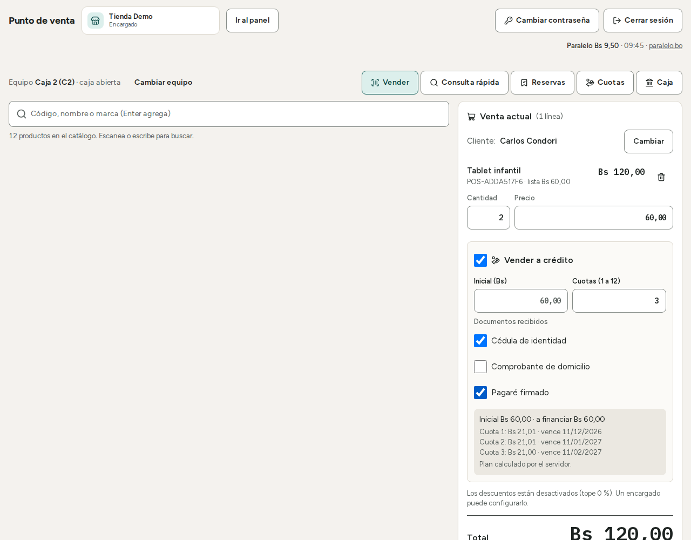

1. Armar el carrito y elegir un cliente: es obligatorio. La lista de precios es "Crédito"; valen el mismo piso de precio y el
   mismo tope de descuento que al contado.
2. Marcar "Vender a crédito". Escribir la "Inicial (Bs)" (mayor a 0 y menor al total; el mínimo por defecto es el 50 % del total
   y la pantalla lo muestra) y elegir las "Cuotas" (por defecto 3, hasta el máximo del negocio).
3. Marcar los "Documentos recibidos": "Cédula de identidad", "Comprobante de domicilio" y "Pagaré firmado". Son casillas; no se
   suben archivos.
4. Revisar el "Plan de cuotas" en pantalla. Si la inicial es menor al mínimo aparece "La inicial es menor al mínimo del negocio.
   Sube la inicial."
5. Pulsar "Cobrar" y cobrar la inicial ("Cobrar la inicial del crédito", "Confirmar cobro"). El resto queda en cuotas
   mensuales con interés (sección 15); la primera vence un mes después de la venta.
6. Desde la nota, "Plan de cuotas" abre el plan para imprimir en A4. Después se vuelve a imprimir desde el detalle del
   crédito, con "Imprimir plan" (sección 15).

Necesita conexión: no se guarda para enviar después. La venta con crédito no se anula ni se devuelve. Revise bien antes de cobrar.
El cálculo del interés (sobre el saldo, con cuota fija) es un supuesto por ahora, a confirmar con el cliente.

### Actualización del punto de venta

Cuando hay una versión nueva, el POS la toma solo al abrirlo, si nadie tocó la pantalla y no hay nada pendiente. Si no, muestra
"Actualización disponible" con el botón "Actualizar ahora": pulsarlo cuando no haya una venta en curso. La primera vez, en cada
equipo con el POS instalado, se pulsa a mano. Detalle en el manual del vendedor.

## 20. Si aparece este mensaje

| Mensaje | Qué hacer |
|---|---|
| "No tienes permiso para esta operación. Pídele a un encargado que la haga." | Su rol no puede hacerlo. Pídalo al dueño o al encargado |
| "No tienes permiso para esto. Pasadas 24 horas de la venta, anular o devolver exige el permiso de devolución fuera de plazo." | La venta pasó de 24 horas. Solo quien tiene permiso de devolución fuera de plazo (dueño y encargado) puede continuar |
| "La caja está cerrada. Una venta de una caja cerrada solo se devuelve, con la caja abierta de un equipo." | Abra una caja en el punto de venta y use "Devolver" |
| "La venta tiene devoluciones." | No se puede anular. Devuelva lo que falta |
| "La venta está anulada." | No admite devolución ni otros cambios |
| "Esa venta es una orden de lavandería: anúlala desde la orden." | Anular desde "Órdenes" |
| "La orden no puede pasar a ese estado." | Los estados avanzan de a un paso. Revise el estado actual |
| "Esa venta completó una reserva: no se puede anular ni devolver desde el sistema." | No tiene reverso automático. Consulte con el dueño |
| "Esa venta tiene un crédito: no se puede anular ni devolver desde el sistema." | No tiene reverso automático. Consulte con el dueño |
| "No hay efectivo suficiente en la caja para esa operación." | Reponga efectivo con un ingreso o use otra caja |
| "Esta operación necesita conexión. Revisa la red y vuelve a intentar." | Revise internet y repita |
| "Sin conexión con el servidor. Revisa la red y vuelve a intentar." | Revise internet y repita |
| "No se pudo completar la operación. Intenta de nuevo." | Repita. Si sigue, avise al soporte |
| "Ya existe un cliente con ese documento. Búscalo y selecciónalo." | Busque al cliente por su documento y úselo |
| "Un producto del carrito ya no tiene precio en esa lista (contado o crédito)." | Cargue el precio en "Precios" |
| "El descuento supera el tope permitido." | Baje el descuento, o pida al dueño subir el tope en "Descuento" |
| "La inicial es menor al mínimo del negocio. Sube la inicial." | Suba la inicial, o cambie el mínimo en "Parámetros del crédito" |
| "El pago supera el saldo del crédito." | Cobre solo el saldo que falta |
| "No hay stock suficiente para reservar esa cantidad en este equipo." | Registre la entrada o reserve menos |
| "La reserva ya no está activa: se completó o se canceló." | Recargue la lista de reservas |
| "Esa operación ya se registró con otros datos. Recarga la página." | Recargue la página y revise el resultado antes de repetir |
| "Alguna de las series ya está registrada o está repetida en la lista." | Revise las series y quite las repetidas |
| "Las series disponibles no pueden superar el stock de esa ubicación. Registra la entrada primero o carga menos series." | Registre la entrada primero |
| "Son demasiados ítems a la vez. Divide el lote." | Divida la carga o el reporte en partes más chicas |
| "El pago supera lo que se le debe al proveedor." | Pague como máximo la deuda actual |
| "Ese crédito ya tiene pagos (o ya no está activo): no se puede anular." | Un saldo inicial con pagos no se anula |
| "Solo un dueño del negocio puede asignar o modificar a un dueño o a un encargado." | Pídalo a un dueño |
| "Es el único dueño activo de uno de sus negocios: nombra o reactiva a otro dueño antes de desactivarlo." | Nombre otro dueño primero |
| "No puedes cambiar tu propio rol ni quitarte a ti mismo." | Pídalo a otro dueño |
| "Es el último negocio de esta cuenta, no se puede quitar. Desactívala en su lugar." | Use "Desactivar" |
| "Una compra de productos con serie no se puede anular." | Esa compra no se anula; corrija con una salida o ajuste |
| "Ya no hay stock suficiente en la ubicación para deshacer la compra: parte se vendió o se movió." | No se puede anular esa compra |
| "La compra tiene pagos al proveedor o la deuda quedaría en negativo. Anula primero el último pago del proveedor." | Anule antes el último pago |
| "Solo se puede anular el último pago del proveedor; ya hay uno más reciente. Recarga la página." | Recargue y anule el más reciente |
| "Ese pago es de una compra al contado: se revierte anulando la compra, no el pago." | Anule la compra |
| "Solo se puede anular el último pago del crédito. Recarga la página." | Recargue y anule el último |
| "La caja elegida no tiene efectivo suficiente para devolver ese pago. Elige otra caja." | Elija otra caja abierta |
| "Hay montos inválidos. No se guardó nada." | En "Precios", revise que ningún precio tenga más de 2 decimales |
| "Ya hay un dispositivo con ese prefijo en este negocio." | Elija otro prefijo |
| "Ya existe una cuenta con ese correo." | Use "Agregar persona de otro negocio" |
| "La contraseña necesita al menos 8 caracteres, con letras y dígitos." | Escriba una contraseña más larga, con letras y números |
| "Tu sesión terminó. Vuelve a ingresar." | Inicie sesión de nuevo |
| "Algo salió mal de nuestro lado. Intenta de nuevo." | Repita. Si sigue, avise al soporte |
