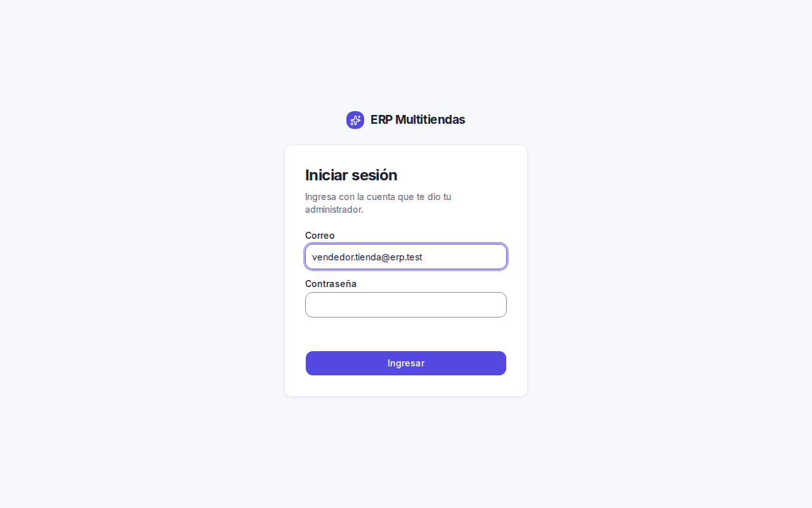
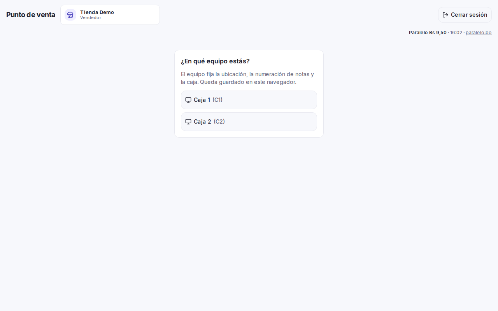
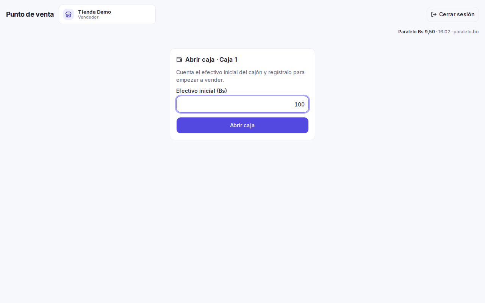
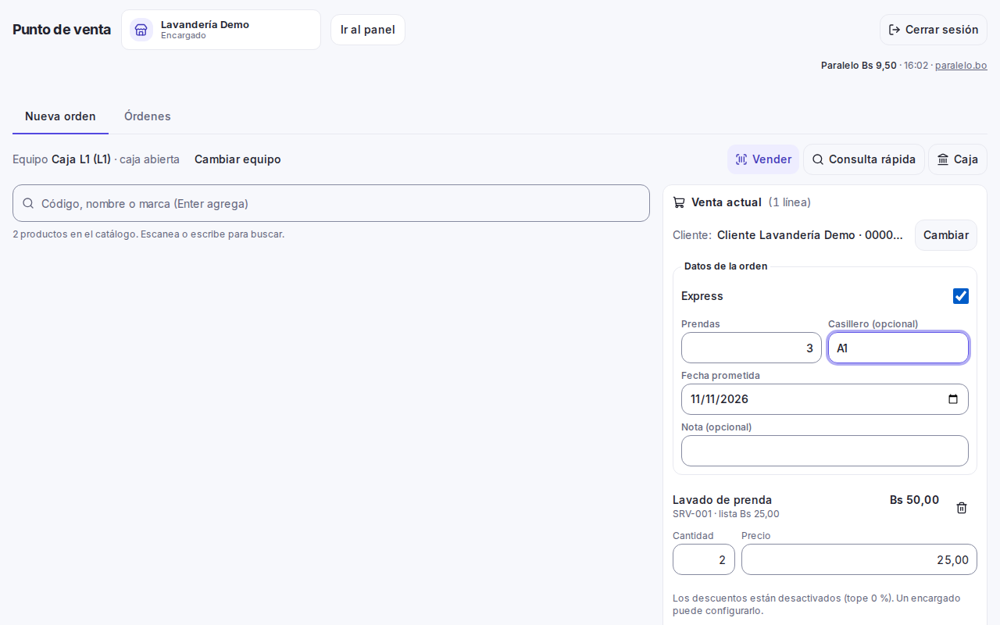
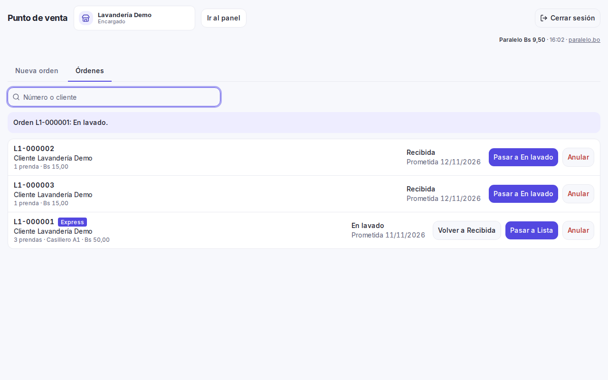
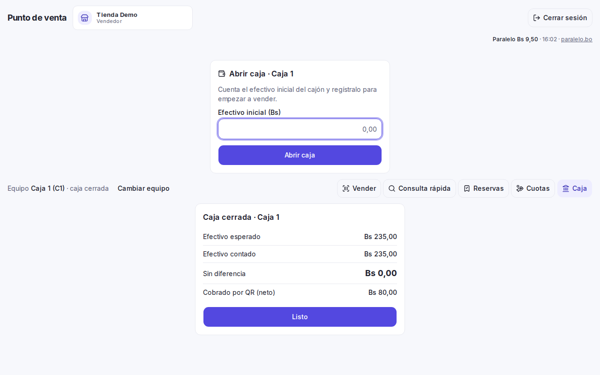

# Manual del empleado de lavandería

Este manual es para quien atiende en la lavandería: recibe la ropa, cobra, avanza las órdenes y entrega. Explica cómo
entrar, abrir la caja, crear una orden, seguirla hasta la entrega y cerrar la caja. Los textos entre comillas son los
que aparecen en pantalla.

## Qué puede y qué no puede hacer el empleado

| Puede | No puede (lo hace el encargado o el dueño) |
|---|---|
| Crear órdenes y cobrarlas | Anular una orden |
| Avanzar el estado de una orden y entregarla | Devolver una venta |
| Dar descuentos, dentro del tope del negocio | Registrar el consumo de insumos (detergente, bolsas, ganchos); por ahora, a confirmar con el cliente |
| Abrir y cerrar su caja; registrar ingresos, gastos y retiros | Cambiar precios de los servicios, usuarios ni equipos |
| | Ver costos ni ganancias |

Si necesita algo de la columna derecha, pídalo al encargado. El botón "Anular" no aparece en su pantalla.

## Entrar y elegir el equipo

1. Abrir la aplicación instalada, o la dirección web que le entregó el encargado, en Chrome o Edge (en el celular, Chrome en
   Android). Firefox no está soportado.
2. Escribir el correo en "Correo" y la contraseña en "Contraseña". Pulsar "Ingresar".

3. Si el negocio tiene varios equipos, aparece "¿En qué equipo estás?". Elegir el equipo propio, por ejemplo "L1".
   El equipo fija la ubicación, la numeración de las boletas y la caja. Queda guardado en este navegador.

Si aparece "Este negocio no tiene equipos registrados", avisar al encargado.

La contraseña inicial se la entregan en persona y no se vuelve a mostrar. Guárdela y no la comparta.

La lavandería tiene su propia caja, separada de la tienda. Todo se cobra en bolivianos (Bs).

## Abrir la caja

1. Contar el efectivo que hay en el cajón.
2. Escribir el monto en "Efectivo inicial (Bs)". Ejemplo: 100 o 100,50.
3. Pulsar "Abrir caja".

Sin caja abierta se puede armar la orden, pero no cobrar. Si aparece "La caja de este equipo está cerrada. Ábrela para
vender.", abrir la caja. La caja se puede abrir sin internet.

## Nueva orden

Se hace en la pestaña "Nueva orden".

1. **Agregar los servicios.** Escribir el nombre del servicio en "Código, nombre o marca (Enter agrega)" y pulsar Enter.
   Corregir la cantidad en el carrito: kilos o piezas, según cómo se cobre ese servicio. Los precios son "Normal" o
   "Exprés"; no se eligen por línea, los fija el interruptor "Express" de la orden.
2. **Elegir el cliente. Es obligatorio.** Pulsar "Elegir" y buscar por "Nombre o documento", o "Nuevo cliente" con
   "Nombre", "CI o NIT" y "Teléfono". Sin cliente no se puede cobrar ("Falta elegir").
3. **Completar "Datos de la orden":**
   - "Express": activar si el cliente pidió servicio urgente. Cobra el precio exprés.
   - "Prendas": cantidad de prendas, mayor a 0.
   - "Casillero (opcional)": hasta 20 caracteres.
   - "Fecha prometida": el día que se entrega. No puede ser anterior a hoy.
   - "Nota (opcional)": hasta 500 caracteres. Anotar aquí cualquier detalle, como una prenda dañada, manchada o perdida. Por ahora el daño o la pérdida de una prenda se registra solo como nota en la orden (a confirmar con el cliente).
4. **Cobrar.** Pulsar "Cobrar" o F2. **Se cobra el total al recibir la ropa.** Efectivo, QR o mixto, igual que en la
   tienda:
   - Efectivo: escribir "Efectivo recibido (Bs)" y ver el "Vuelto".
   - QR: "Todo QR" y marcar "Confirmo que recibí Bs … por QR en mi cuenta." solo después de ver el pago en su celular.
   - Mixto: escribir el monto QR en "Pago por QR (Bs)". El efectivo se ajusta solo.
   Luego "Confirmar cobro".

Por ahora la lavandería no maneja saldos por cobrar: se cobra todo al recibir. Esto es un **supuesto**, a confirmar con
el cliente. Entregar la ropa no revisa el pago.

Los precios de los servicios (por kilo, por prenda, planchado, recargo exprés y cobro mínimo) los carga el negocio en
el sistema. Si un servicio no tiene precio, no se puede vender: avise al encargado.

5. **Entregar la boleta.** Al terminar sale la "BOLETA" con el número de la orden, por ejemplo "L1-000123", el cliente,
   las prendas, el casillero y la entrega. Elegir el tamaño en "Tamaño de papel" ("Ticket 80 mm" o "A4") y pulsar
   "Imprimir". Luego "Nueva orden". El cliente necesita la boleta para retirar su ropa.

La lavandería no tiene impresora por ahora (a confirmar con el cliente). Si no se puede imprimir, se usa el talonario
de siempre y se anota el número de la boleta.

### Descuentos

El empleado de lavandería sí puede dar descuentos, dentro del tope fijado por el negocio.

- El descuento por línea o por toda la venta se escribe en "Descuento" o "Descuento de la venta (Bs)".
- Si lo supera, aparece "El descuento supera el tope permitido."
- Por ahora el tope arranca en 0 %: nadie descuenta hasta que el cliente fije el tope. Mientras tanto aparece "Los
  descuentos están desactivados (tope 0 %). Un encargado puede configurarlo."

## Órdenes: seguimiento

La pestaña "Órdenes" lista las órdenes activas. **Necesita internet**: "Las órdenes necesitan conexión."

- Para encontrar una orden, escribir en "Número o cliente". Ejemplo: "L1-000123" o el nombre.
- Cada orden muestra su estado, "Express" si lo es, el casillero y la fecha prometida. Si la fecha ya pasó dice
  "atrasada".

**Estados de una orden:** "Recibida", "En lavado", "Lista" y, al final, "Entregada".

| Desde | Botón |
|---|---|
| Recibida | "Pasar a En lavado" |
| En lavado | "Pasar a Lista" o "Volver a Recibida" |
| Lista | "Entregar" o "Volver a En lavado" |

Solo se avanza o se retrocede un paso. Otros saltos se rechazan con "La orden no puede pasar a ese estado." Cada cambio
queda registrado con el nombre de quien lo hizo.

## Entregar la orden

1. En "Órdenes", buscar la orden y pulsar "Entregar". Solo se entrega cuando está "Lista".
2. En "Quién retira", escribir el nombre de la persona que retira.
3. En "Documento de retiro", elegir:
   - "Con boleta": la persona presenta la boleta.
   - "Con carnet": si perdió la boleta. Escribir el número en "Documento". Es obligatorio.
4. Pulsar "Entregar".

Revise que las prendas coincidan con la boleta antes de entregar. Una orden entregada no se anula; si hay un problema,
el encargado registra una devolución.

**Ropa sin recoger.** Una orden "Lista" hace más de 30 días aparece en el panel del encargado como "sin recoger". Es un
aviso: qué hacer con la ropa lo decide una persona.

## Anular una orden

El empleado **no puede anular**: el botón "Anular" no aparece en su pantalla. Avise al encargado. El encargado:

- Escribe el motivo en "Motivo de la anulación" (de 1 a 200 caracteres) y pulsa "Anular orden".
- Si la caja de la orden sigue abierta, el efectivo vuelve a esa caja: "Se devolvió el efectivo de la caja."
- Si la caja ya se cerró, no se toca el dinero: "La caja de esa orden ya cerró: si corresponde, registra una
  devolución en Ventas."
- Pasadas 24 horas, o sin efectivo en la caja, la orden no se cancela hasta que se cierre la caja.
- La anulación no se puede deshacer.

## Movimientos de caja: ingreso, gasto y retiro

1. Pulsar "Caja".
2. En "Movimientos de caja", elegir en "Tipo": "Ingreso", "Gasto" o "Retiro".
3. Escribir "Monto (Bs)" mayor a 0 y "Motivo" (hasta 200 caracteres). Ambos son obligatorios.
4. Pulsar "Registrar".

Un gasto o retiro no puede ser mayor al efectivo de la caja: "No hay efectivo suficiente en la caja para esa operación."
Los movimientos se pueden registrar sin internet.

## Sin internet

Si se corta internet, **se siguen recibiendo órdenes**. Aparece la barra "Sin conexión. Catálogo de hace …. Lo registrado
se enviará al volver la red. Cerrar sesión necesita conexión."

**Sin internet se puede:**
- Abrir la caja.
- Crear una orden y cobrarla. La orden queda "guardada en este equipo. Se enviará al volver la conexión." Arriba se ve
  "N ventas sin enviar"; se envían solas al volver la red.
- Registrar ingresos, gastos y retiros.

**Sin internet NO se puede:**
- Ver la pestaña "Órdenes", cambiar el estado de una orden ni entregarla.
- Cerrar la caja.
- Cerrar sesión, cambiar de equipo o de negocio.
- Buscar o crear clientes. En su lugar, la pantalla pide los datos escritos a mano: "Sin conexión: escribe los datos del
  cliente." Escribir "Nombre" y "Teléfono (opcional)". El nombre es obligatorio. Después no se puede vincular con un
  cliente registrado.

El QR sin internet no se puede comprobar. El pago queda como "QR pendiente de verificar" y el encargado lo confirma
después. Mire igual su celular antes de recibir la ropa.

**Importante.**
- No borre los datos del navegador ni limpie el equipo mientras haya órdenes sin enviar: se perderían. Antes, cierre la
  caja y espere a que no quede ninguna operación sin enviar.
- Si pasan más de 72 horas sin conectar el equipo, deja de vender hasta conectarse e iniciar sesión. Las ventas
  pendientes no se pierden.
- Si aparece "Tu sesión caducó…", iniciar sesión de nuevo. Lo pendiente se conserva.
- Si aparece "Actualización disponible", se aplica solo cuando no quedan operaciones sin enviar.
- El número de la boleta puede cambiar al enviarse, si choca con otro. Se conserva la boleta que ya entregó.
- Hasta el fin del paralelo, el cuaderno sigue siendo el registro oficial: cada orden se anota también allí.

## Cerrar la caja

Cerrar la caja necesita internet y que no haya operaciones sin enviar.

1. Pulsar "Caja".
2. Contar el efectivo del cajón. El sistema no muestra cuánto debería haber: así el conteo es ciego.
3. Escribir el monto en "Efectivo contado (Bs)".
4. Pulsar "Cerrar caja" y confirmar en "¿Cerrar la caja de …?". Para volver, "Seguir en caja".

Al cerrar aparece "Efectivo esperado", "Efectivo contado" y la diferencia: "Sin diferencia", "Sobrante" o "Faltante".
También "Cobrado por QR (neto)". Pulse "Listo".

Después del cierre no se pueden registrar más ventas ni movimientos en esa sesión. El cierre no se puede deshacer.

Si aparece "Hay operaciones sin enviar o rechazadas en este equipo. Resuélvelas antes de cerrar la caja.", volver a tener
internet y esperar a que se envíen.

## Operaciones rechazadas

Si el servidor rechaza una operación enviada desde la cola, aparece "N operaciones rechazadas al enviar" (o "1 operación rechazada al enviar") con el motivo y "Reintentar".
Pulse "Reintentar" si el problema ya se arregló. Si sigue rechazada, **no la descarte**: "Para descartar una operación
rechazada avisa al encargado." El cliente ya pagó y descartar no se deshace.

## Si aparece este mensaje

| Mensaje | Qué hacer |
|---|---|
| "No tienes permiso para esta operación. Pídele a un encargado que la haga." | El empleado no tiene ese permiso (por ejemplo, anular). Llamar al encargado. |
| "Hay datos inválidos. Revisa el carrito, las cantidades y las series." | Revisar las cantidades de los servicios y los "Datos de la orden". |
| "Esta operación ya se registró con otros datos. Reinicia la venta." | Pulsar "Nueva orden" y armarla otra vez. Antes, confirmar con el encargado que la anterior no quedó registrada. |
| "La caja de este equipo está cerrada. Ábrela para vender." | Abrir la caja con "Efectivo inicial (Bs)". |
| "Este equipo ya tiene una caja abierta." | No abrir otra. Seguir con la caja abierta. |
| "No hay efectivo suficiente en la caja para esa operación." | Registrar un monto menor o avisar al encargado. |
| "Un producto del carrito ya no tiene precio en esa lista (contado o crédito)." | Un servicio perdió su precio. Quitarlo y avisar al encargado. |
| "El descuento supera el tope permitido." | Bajar el descuento. |
| "El número de nota ya existe." | Reintentar. Si se repite, avisar al encargado. |
| "Ya existe un cliente con ese documento. Búscalo y selecciónalo." | Usar "Elegir" y buscar al cliente por su CI o NIT. |
| "La orden no puede pasar a ese estado." | Solo se avanza o se vuelve un paso. Revisar el estado actual de la orden. |
| "Esa venta es una orden de lavandería: anúlala desde la orden." | Avisar al encargado: la anulación se hace desde la orden. |
| "Esta operación necesita conexión. Revisa la red y vuelve a intentar." | Esperar a que vuelva internet. |
| "Sin conexión con el servidor. Revisa la red y vuelve a intentar." | Revisar el wifi o los datos del equipo y reintentar. |
| "No se pudo completar la operación. Intenta de nuevo." | Reintentar. Si se repite, avisar al encargado y no cobrar de nuevo sin verificar. |
| "Hay operaciones sin enviar o rechazadas en este equipo. Resuélvelas antes de cerrar la caja." | Esperar a que se envíen. Si hay rechazadas, avisar al encargado. |
| "Escribe quién retira." / "Escribe el documento de quien retira." | Completar "Quién retira" y, si es con carnet, el "Documento". |
| "Hace más de 72 horas que este equipo no se conecta…" | Conectar el equipo a internet e iniciar sesión. Lo pendiente no se pierde. |
