# Manual del vendedor: punto de venta

Este manual es para quien atiende el mostrador de la tienda o del frial. Explica, paso a paso, cómo entrar, abrir la
caja, vender, cobrar, imprimir la nota y cerrar la caja. Los textos entre comillas son los que aparecen en pantalla.

## Qué puede y qué no puede hacer el vendedor

| Puede | No puede (lo hace el encargado o el dueño) |
|---|---|
| Vender y cobrar en efectivo, QR o mixto | Anular una venta |
| Abrir y cerrar su caja y registrar ingresos, gastos y retiros | Devolver una venta, ni siquiera el mismo día |
| Crear y completar reservas con anticipo | Cancelar una reserva |
| Cobrar cuotas de un crédito por caja | Bajar el precio por debajo del mínimo o dar descuento |
| Consultar precio y stock | Crear una venta a crédito |
| | Ver costos ni ganancias |
| | Crear usuarios, equipos ni cambiar el tope de descuento |

Si necesita algo de la columna derecha, pídalo al encargado. El encargado lo hace desde su propia sesión. En el
punto de venta no existe una clave de autorización que el encargado pueda escribir en el equipo del vendedor.

## Entrar y elegir el equipo

1. Abrir la aplicación instalada, o la dirección web que le entregó el encargado, en Chrome o Edge (en el celular, Chrome en
   Android). Firefox no está soportado.
   Para instalarla en el equipo, abrir la dirección del punto de venta en Chrome o Edge y usar la opción del navegador
   "Instalar aplicación" (en el celular, "Agregar a la pantalla principal"). Se instala el punto de venta; el panel del
   encargado se instala aparte.
2. Escribir el correo en "Correo" y la contraseña en "Contraseña". Pulsar "Ingresar".

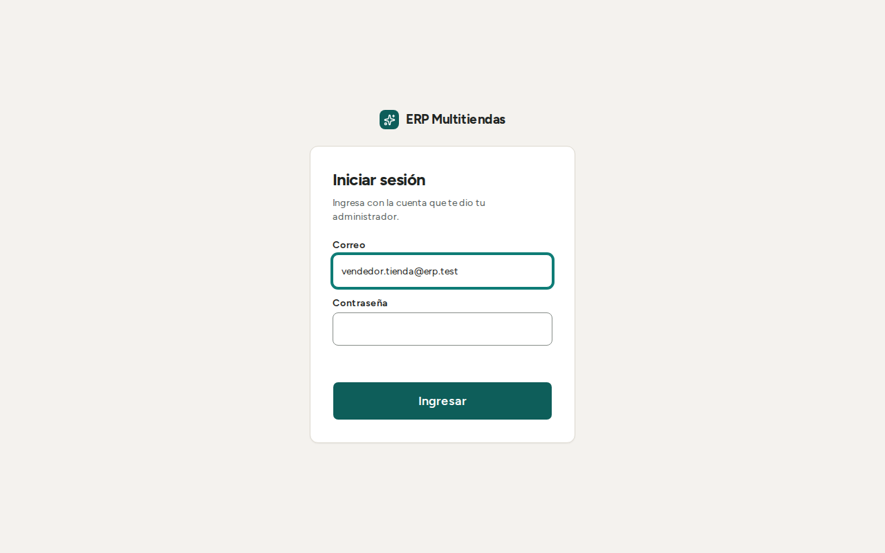

3. Si el negocio tiene varios equipos, aparece "¿En qué equipo estás?". Elegir el equipo propio, por ejemplo "C1".
   El equipo fija la ubicación, la numeración de las notas y la caja. Queda guardado en este navegador.

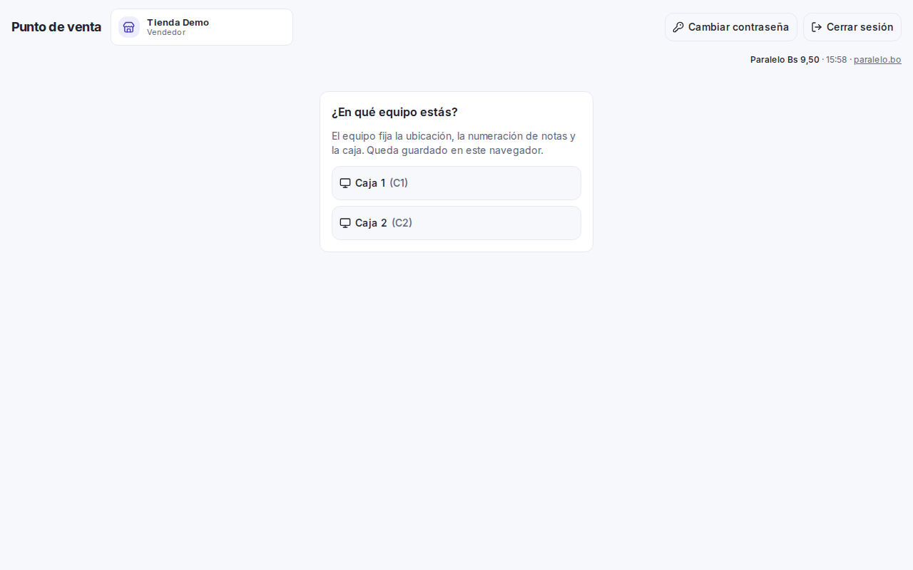

Si aparece "Este negocio no tiene equipos registrados", avisar al encargado: el equipo se registra en el panel.

Para cambiar de equipo, pulsar "Cambiar equipo". No se puede cambiar de equipo ni cerrar sesión sin internet, ni
cuando hay operaciones sin enviar.

**La contraseña.** La contraseña inicial se la entregan en persona y no se vuelve a mostrar. Guárdela y no la comparta.
Para cambiarla, pulse "Cambiar contraseña" (junto a "Cerrar sesión"), escriba la "Contraseña actual", la "Contraseña nueva"
y repítala (8 caracteres o más, con letras y números). Si la olvidó, pida al encargado o al dueño que la restablezca.

## Abrir la caja

1. Contar el efectivo que hay en el cajón.
2. Escribir el monto en "Efectivo inicial (Bs)". Ejemplo: 100 o 100,50.
3. Pulsar "Abrir caja".

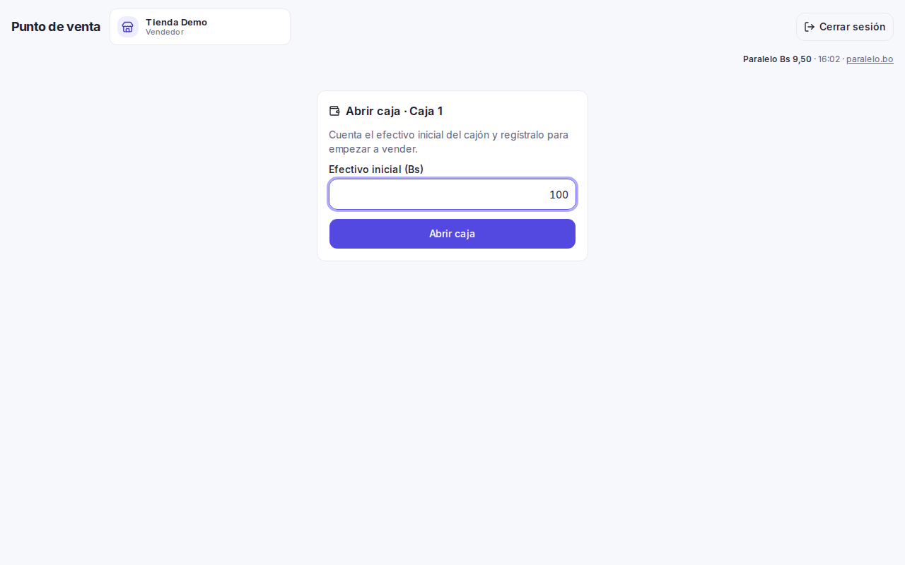

Sin caja abierta se puede armar el carrito, pero no se puede cobrar. Si aparece "La caja de este equipo está cerrada.
Ábrela para vender.", abrir la caja. Cada equipo tiene una sola caja abierta a la vez.

La caja se puede abrir sin internet: queda guardada en el equipo y se envía al volver la conexión.

## Vender

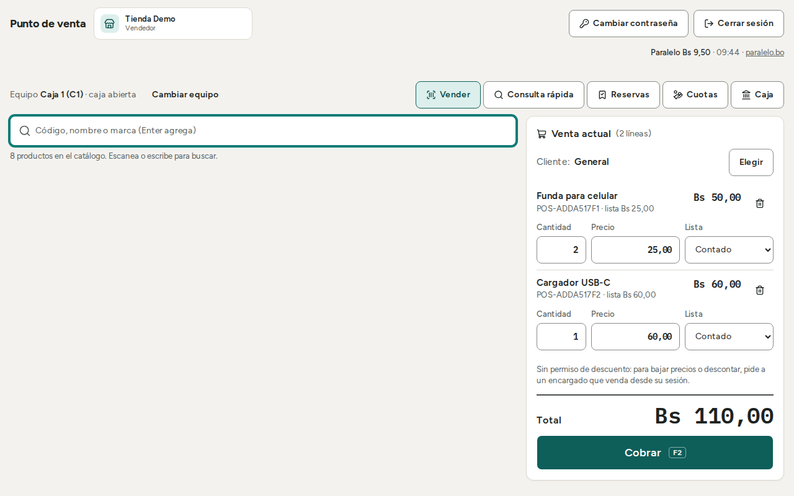

1. **Buscar el producto.** Escanear el código de barras con el lector. También se puede escribir código, nombre o
   marca en "Código, nombre o marca (Enter agrega)" y pulsar Enter. La tecla "/" vuelve a la búsqueda desde cualquier
   parte de la pantalla. Si el código coincide con más de un producto, no se agrega nada y aparece "Ese código coincide
   con N productos: elige uno." Elegir el producto de la lista. La búsqueda no distingue tildes.
2. **Revisar el carrito.** Cada línea muestra "Cantidad", "Precio" y "Lista". Se corrige ahí:
   - Cantidad: entera para productos por unidad.
   - Precio: se puede bajar solo hasta el precio mínimo del producto (ver "Descuentos").
   - Lista: la lista por defecto es "Contado". Se puede elegir otra por línea: "Mayorista" o "Mínimo". La lista "Crédito" no se elige por línea: la usa
     solo la venta a crédito.
   - Para quitar una línea, usar el botón de quitar de esa línea.
3. **Elegir el cliente** (opcional en tienda y frial). Por defecto es "General". Ver la sección "Cliente".
4. **Cobrar.** Pulsar "Cobrar" o la tecla F2. Ver "Cobrar".

Si un producto muestra "Stock aquí: 0" en rojo, el sistema deja venderlo igual. Ver "Stock en cero".

**Consulta rápida.** El botón "Consulta rápida" permite ver precio y stock sin vender: "Consultar precio y stock…". Los
servicios de lavandería se ven en la consulta pero no se pueden vender en la tienda ni en el frial.

**Precio faltante.** Si un producto no tiene precio en la lista elegida, el sistema avisa, por ejemplo: "Un producto
del carrito ya no tiene precio en esa lista (contado o crédito)." No se puede vender hasta que el encargado cargue el
precio en el panel. Si el negocio no tiene ningún producto con precio, la pantalla dice "Este negocio todavía no tiene
productos con precio. Pide al encargado que los cargue en el panel."

**Productos con número de serie.** Cada línea vende una sola unidad y hay que elegir la serie ("Elige la serie").
Vender un producto con serie necesita internet. Hoy la mayoría de los productos no llevan serie; el encargado le avisa
cuáles sí. Esto está por confirmar con el cliente.

**Moneda.** Todo se cobra en bolivianos (Bs). Por ahora se supone que el dólar solo sirve para fijar los precios y no se cobra en dólares; está por confirmar con el cliente.

### Venta por peso en el frial

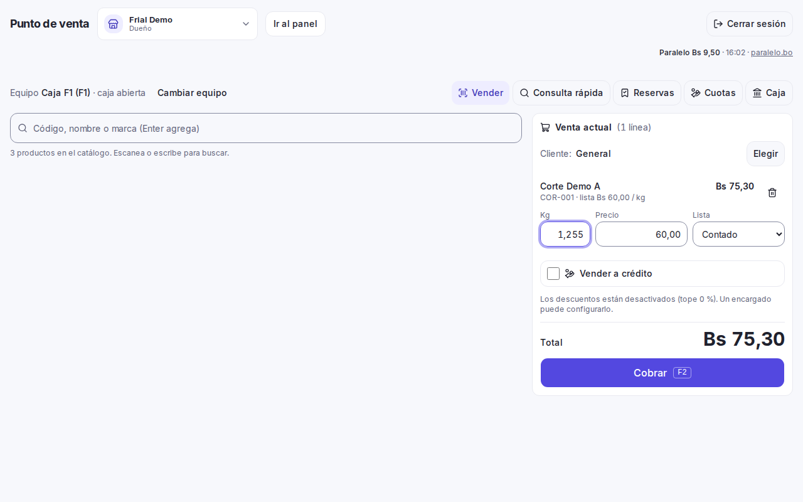

En el frial hay tres tipos de producto:

- **Por peso variable.** La cantidad se llama "Kg". Escribir lo que marca la balanza, con hasta 3 decimales
  (por ejemplo 1,250). El total se redondea a 2 decimales. El sistema no se conecta a la balanza: el peso se escribe
  a mano.
- **Por unidad.** "Cantidad" entera.
- **Paquete de peso fijo.** Se cobra por paquete y la cantidad es entera.

Si escribe más de 3 decimales aparece "Cantidad inválida (hasta 3 decimales)". Si escribe decimales en un producto por
unidad aparece "Cantidad entera".

El cajero no elige el lote ni el vencimiento al vender; eso lo controla el encargado.

## Cliente

Por defecto la venta es para "General". Para poner un cliente:

1. Pulsar "Elegir" y buscar por "Nombre o documento".
2. Si el cliente no existe, pulsar "Nuevo cliente" y completar "Nombre", "CI o NIT" y "Teléfono".
3. Para cambiarlo, "Cambiar". Para volver a General, "Quitar cliente".

El CI o NIT no se repite dentro del negocio. Si aparece "Ya existe un cliente con ese documento. Búscalo y
selecciónalo.", buscarlo con "Elegir".

La búsqueda de clientes no distingue tildes: "Jose" encuentra "José". Buscar o crear clientes necesita internet. Sin internet, la venta sigue como "General".

## Cobrar

Pulsar "Cobrar" o F2. Se abre "Cobrar venta" con el total.

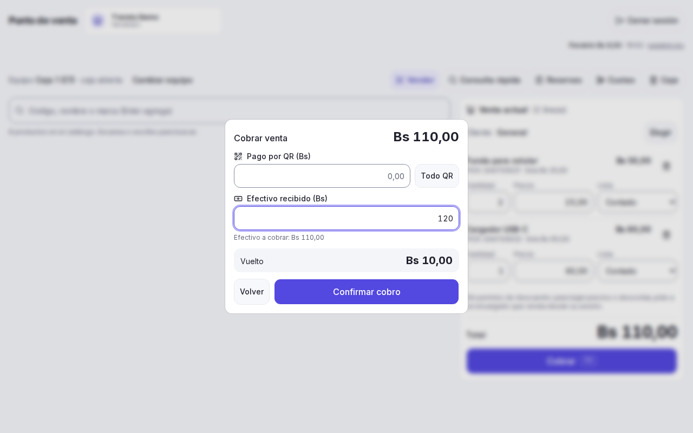

**Solo efectivo.** Escribir lo recibido en "Efectivo recibido (Bs)". El sistema muestra el "Vuelto". El vuelto es solo
para darle al cliente: no se guarda.

**Solo QR.** Pulsar "Todo QR". Mirar en su celular que el pago llegó a la cuenta del negocio. Solo después marcar
"Confirmo que recibí Bs … por QR en mi cuenta." Sin esa marca la venta no se registra.

**Mixto (efectivo y QR).** Escribir el monto QR en "Pago por QR (Bs)". El efectivo se ajusta solo. Confirmar el QR
como en el caso anterior.

Luego pulsar "Confirmar cobro". Si desea corregir algo, "Volver".

Si el cobro se queda en "Enviando…" o aparece "Cobro sin confirmar", no cobre otra vez al cliente. Pulse "Reintentar
cobro" o "Descartar y verificar" para saber si la venta quedó registrada.

Una venta normal, en efectivo o QR, se guarda en el equipo y se envía sola: no muestra el aviso que sigue. Algunos
cobros van directo al servidor y no se guardan para después: el de la venta que completa una reserva y el de una cuota
(la venta a crédito la cobra el encargado). Si recarga la página a mitad de uno de ellos, arriba queda un aviso fijo: "Cobro sin confirmar: C1-000005, Bs … No
entregues el producto hasta verificar." Pulse "Verificar cobro": el sistema consulta si la venta quedó registrada, sin
cobrar de nuevo. Lo mismo pasa con una cuota, en la pantalla "Cuotas". Mientras haya un cobro sin confirmar, no se puede
cerrar la caja.

Si una venta se envió y no hubo respuesta, queda "en duda": no se borra hasta saber con certeza si se registró, y antes
de reenviarla el equipo comprueba si ya llegó. Si la sesión caducó, la venta espera hasta que vuelva a iniciar sesión.

### Imprimir la nota

Al terminar aparece la nota de venta con su número, por ejemplo "C1-000123". El número lleva el prefijo del equipo y seis dígitos. Al llegar a 999999 el equipo avisa "Numeración del equipo agotada,
avisa al encargado."

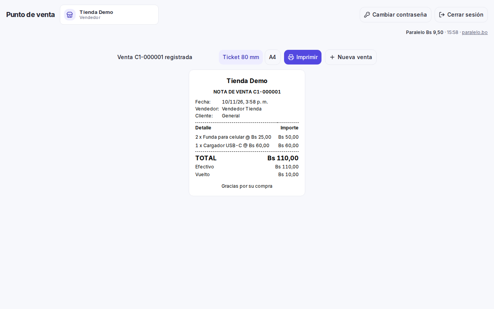

1. En "Tamaño de papel" elegir "Ticket 80 mm" o "A4".
2. Pulsar "Imprimir". También se puede guardar como PDF desde la ventana de impresión.
3. Pulsar "Nueva venta" para seguir.

La nota de venta lleva el nombre del negocio, número, vendedor, cliente, líneas, garantía, descuentos y pagos. El NIT y
los demás datos del negocio (dirección, teléfono) salen solo si el dueño los cargó en "Datos del negocio"; si no, la
nota sale sin ellos. La fecha sale con día, mes, año y hora de Bolivia, por ejemplo "09/11/2026 17:29". No es una
factura: el sistema no está conectado a Impuestos Nacionales.

La nota se imprime por el navegador, o se guarda como PDF; el cajón de dinero no se abre solo al imprimir. Por ahora el
ticket de 80 mm sale en papel de 80 × 297 mm. Qué impresora usará cada negocio está por confirmar con el
cliente; mientras tanto la nota se puede guardar como PDF.

## Descuentos y precio mínimo

- Hasta el **precio mínimo** de cada producto se puede negociar sin permiso. Se baja el precio en la línea del carrito.
- Por debajo del mínimo, o para dar un descuento, hace falta el permiso de descuento. El vendedor no lo tiene. Aparece:
  "Sin permiso de descuento: para bajar precios o descontar, pide a un encargado que venda desde su sesión." o, en la
  línea, "Bajo el mínimo (…). Pide a un encargado."
- Cuando el encargado da un descuento, tiene un tope fijado por el negocio. Si lo supera aparece "El descuento supera
  el tope permitido." Por ahora el tope arranca en 0 %: nadie descuenta hasta que el cliente fije el tope.

El cliente que pide rebaja debe ser atendido por el encargado en su propio equipo o sesión.

## Stock en cero

El sistema deja vender aunque el stock sea 0 o insuficiente; se ve "Stock aquí: 0" en rojo. La venta se hace y el stock
queda en negativo. El encargado lo ve en "Reconciliación" para revisarlo. Avísele cuando venda algo sin stock, para que
revise el conteo.

## Sin internet

Si se corta internet, **se sigue vendiendo**. Aparece la barra: "Sin conexión. Catálogo de hace …. Lo registrado se
enviará al volver la red. Cerrar sesión necesita conexión."

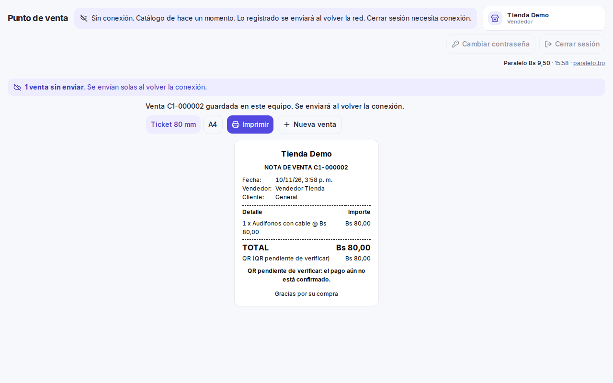

Al cobrar, la nota dice "guardada en este equipo. Se enviará al volver la conexión." Arriba se ve "N ventas sin
enviar". Esas ventas se envían solas al volver la red. No hay que hacer nada. Una nota guardada en el equipo que quedó sin
imprimir no se puede reimprimir después: imprímala al cobrar.

**Sin internet se puede:**
- Vender en efectivo y por QR.
- Abrir la caja.
- Registrar ingresos, gastos y retiros.

**Sin internet NO se puede:**
- Cerrar la caja.
- Cerrar sesión, cambiar de equipo o cambiar de negocio.
- Buscar o crear clientes.
- Vender productos con número de serie.
- Crear, completar o cancelar reservas.
- Cobrar cuotas ni consultar saldos de crédito.
- Anular o devolver (lo hace el encargado de todos modos).

**El QR sin internet.** No se puede comprobar que el pago llegó. La venta queda como "QR pendiente de verificar" y el
encargado la confirma después. Mire igual su celular antes de entregar el producto.

**Precios sin internet.** Sin conexión el servidor no revisa los precios: una venta con precio bajo el mínimo se
acepta y queda marcada para que el encargado la revise. No venda por debajo del mínimo.

**El número de la nota** puede cambiar al enviarse, si choca con otro. Se conserva la nota que ya imprimió.

**Importante.**
- No borre los datos del navegador ni limpie el equipo mientras haya ventas sin enviar: se perderían. Antes de limpiar,
  cierre la caja y espere a que no quede ninguna operación sin enviar.
- Si pasan más de 72 horas sin conectar el equipo, deja de vender hasta conectarse e iniciar sesión. Aparece "Hace más
  de 72 horas que este equipo no se conecta. Conéctalo a internet e inicia sesión para vender. Las ventas pendientes no
  se pierden."
- La primera vez que se usa un equipo hay que abrir la caja con internet, para bajar el catálogo.
- Si aparece "Tu sesión caducó. La venta en pantalla no se pierde: inicia sesión…", iniciar sesión de nuevo. Lo pendiente
  se conserva.
- Actualización del punto de venta: al abrirlo, se actualiza solo si nadie tocó la pantalla y no hay nada pendiente
  (operaciones sin enviar, cobros sin confirmar ni carrito). Si no, aparece "Actualización disponible" con el botón
  "Actualizar ahora": púlselo cuando no esté vendiendo. Si hay operaciones sin enviar o rechazadas, el botón no se puede
  usar hasta resolverlas. La primera vez después de esta entrega, cada equipo necesita pulsar "Actualizar ahora" una vez;
  desde la siguiente se actualiza solo. Con dos pestañas abiertas, una puede quedar con la versión vieja: recárguela
  cuando aparezca "La aplicación se actualizó en otra pestaña."
- Si ve un aviso de operaciones de otro negocio sin enviar, entre con la cuenta y el negocio que las hicieron: solo así se envían.
- En el cambio de turno, si entra otra cuenta del mismo negocio, lo pendiente del turno anterior se envía igual y queda
  marcado como "Enviada desde otra cuenta". Lo pendiente de otro negocio no se envía con esta
  cuenta.
- Hasta el fin del paralelo, el cuaderno sigue siendo el registro oficial: cada venta se anota también allí.

Se recomienda que el negocio tenga un respaldo de internet por 4G.

## Movimientos de caja: ingreso, gasto y retiro

1. Pulsar "Caja".
2. En "Movimientos de caja", elegir en "Tipo": "Ingreso", "Gasto" o "Retiro".
3. Escribir "Monto (Bs)" mayor a 0 y "Motivo" (hasta 200 caracteres). Ambos son obligatorios.
4. Pulsar "Registrar".

Un gasto o retiro no puede ser mayor al efectivo que hay en la caja: aparece "No hay efectivo suficiente en la caja para
esa operación." Los movimientos se pueden registrar sin internet; se envían al volver la conexión.

Los pagos a proveedores no se hacen por la caja del punto de venta. Si se paga con plata del cajón, el encargado
registra además un gasto de caja.

## Cerrar la caja

Cerrar la caja necesita internet y que no haya operaciones sin enviar.

1. Pulsar "Caja".
2. Contar el efectivo del cajón. El sistema no le muestra cuánto debería haber: así el conteo es ciego.
3. Escribir el monto en "Efectivo contado (Bs)".
4. Pulsar "Cerrar caja" y confirmar en "¿Cerrar la caja de …?". Para volver, "Seguir en caja".

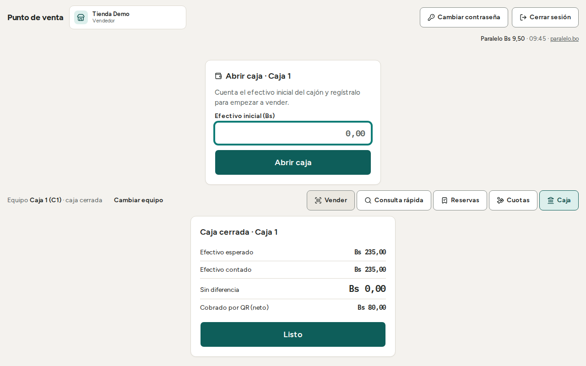

Al cerrar aparece el resultado: "Efectivo esperado", "Efectivo contado" y la diferencia: "Sin diferencia", "Sobrante" o
"Faltante". También se muestra "Cobrado por QR (neto)". Pulse "Listo".

Después del cierre no se pueden registrar más ventas ni movimientos en esa sesión. El cierre no se puede deshacer ni
cambiar: si repite el cierre con el mismo monto da el mismo resultado; con otro monto, da error.

Si aparece "Hay operaciones sin enviar, una apertura de caja rechazada o cobros sin confirmar en este equipo. Resuélvelos
antes de cerrar la caja.", volver a tener internet, esperar a que se envíen las ventas y verificar los cobros sin
confirmar ("Verificar cobro").

Una venta o un movimiento rechazado no impide cerrar: la pantalla avisa "Hay N operaciones rechazadas sin resolver"
y, aparte, las "de cajas anteriores". Avise al encargado: él las reintenta o las descarta. El efectivo de una venta
rechazada no cuenta en el esperado y aparece como diferencia del cierre.

## Operaciones rechazadas

Si el servidor rechaza una operación enviada desde la cola, aparece el aviso "N operaciones rechazadas al enviar" (o "1 operación rechazada al enviar") con el motivo y el
botón "Reintentar".

1. Leer el motivo.
2. Pulsar "Reintentar" si el problema ya se arregló (por ejemplo, se abrió la caja o volvió la red).
3. Si sigue rechazada, **no la descarte**. Avise al encargado: "Para descartar una operación rechazada avisa al
   encargado." El cliente ya pagó y descartar no se deshace: el stock y la caja no reflejarían la venta.

Solo el encargado o el dueño pueden descartar una operación rechazada. Pasados 30 días del cierre de esa caja, una venta
rechazada no se puede reintentar: solo descartar. Mientras haya una operación rechazada, el equipo no se puede
actualizar (ver "Sin internet").

## Reservas con anticipo (tienda y frial)

Una reserva aparta un producto para un cliente que deja un anticipo. Solo existe en la tienda y el frial. Necesita
internet y caja abierta: "Las reservas necesitan conexión: no se pueden crear, cancelar ni completar sin red." Estas
operaciones, igual que el crédito, nunca se guardan para enviar después.

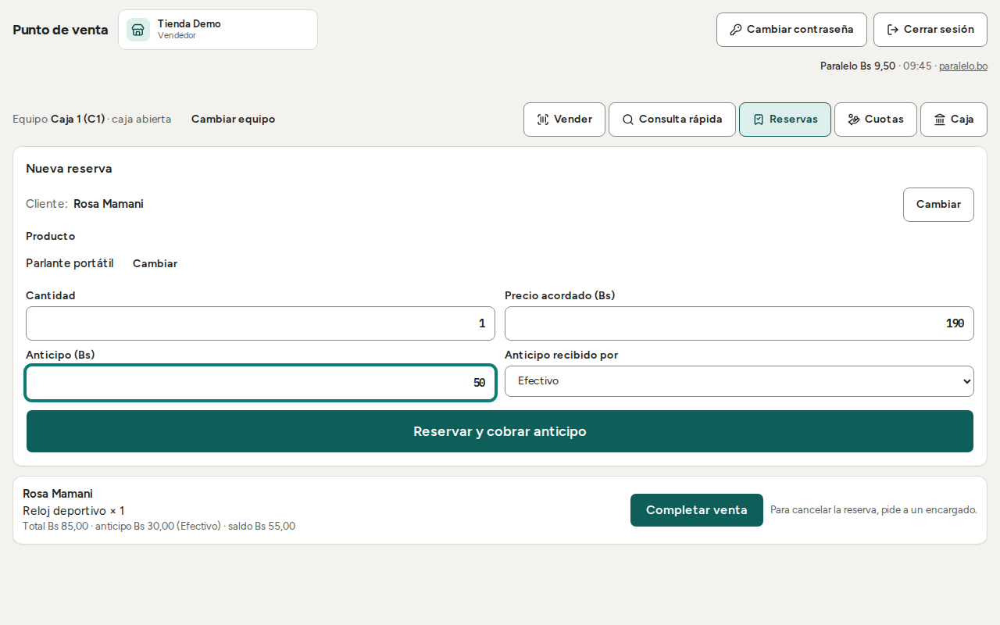

**Crear una reserva.**
1. Pulsar "Reservas". Aparece el formulario "Nueva reserva".
2. Elegir el cliente (obligatorio), el "Producto", la "Cantidad" y el "Precio acordado (Bs)".
3. Escribir el "Anticipo (Bs)" y elegir en "Anticipo recibido por": "Efectivo" o "QR". Con QR, marcar "Confirmo que recibí
   el anticipo por QR en mi cuenta."
4. Pulsar "Reservar y cobrar anticipo". Aparece "Reserva creada: stock apartado y anticipo en caja."

Reglas:

- Una reserva lleva **un solo producto**. Si el cliente reserva varios, se hacen reservas separadas.
- Un producto con número de serie no se puede reservar.
- Hace falta stock suficiente en el equipo. Si no, aparece "No hay stock suficiente para reservar esa cantidad en este
  equipo." La reserva aparta el stock: baja el stock disponible.
- El precio acordado sigue las mismas reglas que una venta: no puede ser menor al precio mínimo (sin permiso de
  descuento, ver "Descuentos").
- El anticipo entra a la caja, en efectivo o QR, y se suma al conteo de la caja. El QR del anticipo se confirma en el
  mostrador y después no se puede marcar como rechazado.

**Completar una reserva.** Cuando el cliente vuelve a retirar:

1. Dejar el carrito vacío. Si no, aparece "Termina o vacía la venta en curso".
2. En "Reservas", pulsar "Completar venta" en la reserva. Se carga el producto en la venta: "Estás completando una
   reserva: no se pueden agregar más productos." Si quiere soltar la reserva sin vender, "Descartar reserva".
3. Cobrar. El anticipo ya se descuenta: "Total … menos el anticipo de la reserva …". Esta venta no admite descuento ni
   crédito.

Una reserva reservada en otro equipo dice "Reservada en …" y se completa en ese equipo: "Se completa en …".

**Cancelar una reserva.** Lo hace un encargado o el dueño, no el vendedor: el botón "Cancelar" no aparece y dice "Para
cancelar la reserva, pide a un encargado." El encargado confirma "Cancelar reserva". Se libera el stock y **por ahora** se devuelve
el anticipo por la caja, en el mismo medio y monto. Si no hay efectivo suficiente en la caja, la cancelación se rechaza. Esta
regla del anticipo está por confirmar con el cliente.

**Una venta que completó una reserva no se anula ni se devuelve** desde el sistema: "Esa venta completó una reserva: no
se puede anular ni devolver desde el sistema." Revise bien antes de cobrar.

## Venta a crédito (tienda y frial)

**El vendedor no crea ventas a crédito.** Solo la hacen el encargado o el dueño, desde su propia sesión: el botón "Vender a
crédito" no aparece en la pantalla del vendedor. Si un cliente pide comprar a crédito, llame al encargado. Usted sí cobra las
cuotas (ver más abajo). Para informar al cliente, conviene saber:

- El cliente es **obligatorio** y la venta usa la lista de precios "Crédito".
- Se paga una **inicial** al comprar, mayor a 0, con un mínimo fijado por el negocio. El resto queda en cuotas **mensuales**
  con interés. Cuántas cuotas y cuánto interés lo define el negocio.
- El cálculo del interés (sobre el saldo que queda, con cuota fija) es un **supuesto** por ahora, a confirmar con el cliente.
- El encargado marca los documentos recibidos: cédula de identidad, comprobante de domicilio y pagaré firmado. No se suben
  archivos.
- Al terminar, el cliente puede recibir impreso su plan de cuotas.
- **Una venta con crédito no se anula ni se devuelve:** "Esa venta tiene un crédito: no se puede anular ni devolver desde
  el sistema."

## Cobrar cuotas

El cobro de cuotas es del vendedor, por caja. Necesita internet y caja abierta: "Cobrar cuotas necesita conexión: no se
puede cobrar ni consultar saldos sin red." Sin caja abierta el botón "Cobrar cuota" no funciona (su ayuda dice "Abre la caja para cobrar").

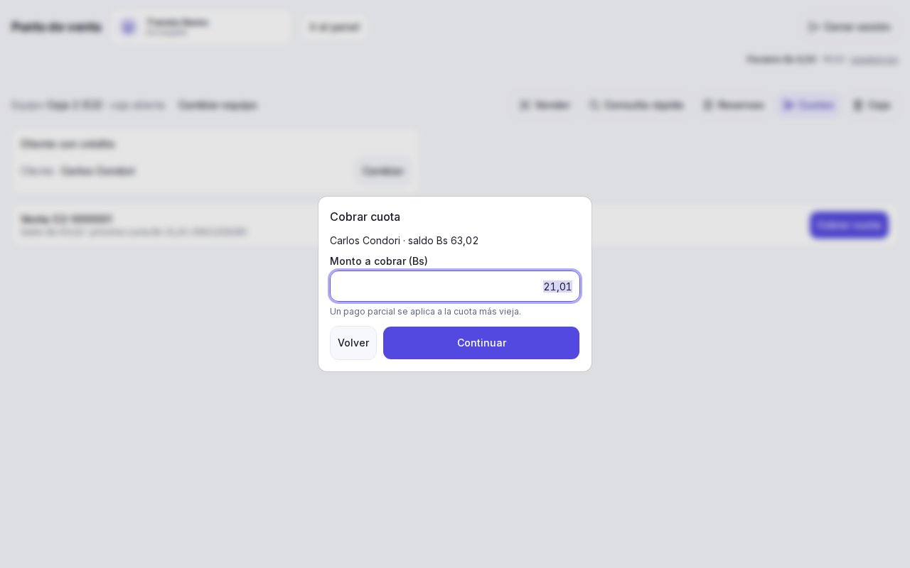

1. Pulsar "Cuotas".
2. En "Cliente con crédito", buscar al cliente. Aparecen sus créditos con saldo, la próxima cuota y, si hay, las
   "cuotas vencidas".
3. Pulsar "Cobrar cuota" en el crédito que corresponda.
4. Escribir "Monto a cobrar (Bs)", mayor a 0 y hasta el saldo. Se puede cobrar menos que una cuota: un pago parcial se
   aplica a la cuota más vieja primero.
5. Elegir efectivo, QR o mixto y "Confirmar cobro", igual que en una venta. Aparece "Cuota cobrada: …".

Si el pago supera el saldo aparece "El pago supera el saldo del crédito." Si el cliente no tiene créditos con saldo
aparece "… no tiene créditos con saldo."

El QR de una cuota se confirma en el mostrador y después no se puede marcar como rechazado: mire su celular antes de confirmar.

No hay recibo impreso de la cuota: el comprobante es el saldo que se ve en pantalla. Si el cobro queda "sin confirmar",
no dé el recibo por válido hasta saber qué pasó: use "Descartar y verificar".

## Qué no puede hacer el vendedor

- **Anular o devolver una venta.** Ni el mismo día. Si el cliente reclama, el encargado lo hace desde el panel, en
  "Ventas". Si una operación sale con "No tienes permiso para esta operación. Pídele a un encargado que la haga.", es esto.
- Bajar el precio por debajo del mínimo o dar descuentos.
- Crear una venta a crédito.
- Descartar una operación rechazada.
- Cancelar una reserva.
- Cambiar productos, precios, inventario o usuarios.

## Si aparece este mensaje

| Mensaje | Qué hacer |
|---|---|
| "No tienes permiso para esta operación. Pídele a un encargado que la haga." | El vendedor no tiene ese permiso. Llamar al encargado. |
| "Hay datos inválidos. Revisa el carrito, las cantidades y las series." | Revisar cantidades (enteras o con hasta 3 decimales en kg) y elegir la serie si el producto la pide. |
| "Esta operación ya se registró con otros datos. Reinicia la venta." | Pulsar "Nueva venta" y armar la venta otra vez. Antes, confirmar con el encargado que la anterior no quedó registrada. |
| "La caja de este equipo está cerrada. Ábrela para vender." | Abrir la caja con "Efectivo inicial (Bs)". |
| "Este equipo ya tiene una caja abierta." | No abrir otra. Seguir vendiendo con la caja abierta. |
| "No hay efectivo suficiente en la caja para esa operación." | El gasto, retiro o devolución de anticipo es mayor al efectivo disponible. Registrar un monto menor o avisar al encargado. |
| "Un producto del carrito ya no tiene precio en esa lista (contado o crédito)." | Quitar el producto o cambiar de lista. Avisar al encargado para que cargue el precio. |
| "El descuento supera el tope permitido." | Bajar el descuento. Avisar al encargado. |
| "El número de nota ya existe." | Reintentar. Si se repite, avisar al encargado. |
| "Ya existe un cliente con ese documento. Búscalo y selecciónalo." | Usar "Elegir" y buscar al cliente por su CI o NIT. |
| "No hay stock suficiente para reservar esa cantidad en este equipo." | Reservar una cantidad menor. |
| "La reserva ya no está activa: se completó o se canceló." | Actualizar la lista de "Reservas". Esa reserva ya no se puede usar. |
| "Esa venta completó una reserva: no se puede anular ni devolver desde el sistema." | No se puede revertir. Avisar al encargado. |
| "Esa venta tiene un crédito: no se puede anular ni devolver desde el sistema." | No se puede revertir. Avisar al encargado. |
| "El pago supera el saldo del crédito." | Cobrar un monto menor o igual al saldo. |
| "Esta operación necesita conexión. Revisa la red y vuelve a intentar." | Esperar a que vuelva internet. Reservas, cuotas, clientes y cierre de caja no se pueden hacer sin red. |
| "Sin conexión con el servidor. Revisa la red y vuelve a intentar." | Revisar el wifi o los datos del equipo y reintentar. |
| "No se pudo completar la operación. Intenta de nuevo." | Reintentar. Si se repite, avisar al encargado y no cobrar de nuevo sin verificar. |
| "Hay operaciones sin enviar, una apertura de caja rechazada o cobros sin confirmar en este equipo. Resuélvelos antes de cerrar la caja." | Esperar a que se envíen y usar "Verificar cobro" en los cobros sin confirmar. Si hay una apertura rechazada, avisar al encargado. |
| "Hay N operaciones rechazadas sin resolver…" | No impide cerrar la caja. Avisar al encargado para que las reintente o las descarte. |
| "Cobro sin confirmar: C1-000005, Bs … No entregues el producto hasta verificar." | No cobrar de nuevo. Pulsar "Verificar cobro". |
| "Ese código coincide con N productos: elige uno." | Elegir el producto de la lista. |
| "Para cancelar la reserva, pide a un encargado." | Llamar al encargado: él cancela la reserva. |
| "La reserva ya quedó registrada con los datos del primer intento; revísala en la lista. Si hace falta otra, envía de nuevo." | No reservar otra vez: ver la lista de "Reservas". |
| "La cancelación ya quedó registrada con el primer intento; revisa la lista de reservas." | Revisar la lista de "Reservas". |
| "Ya se registró un cobro con este intento por otro monto; revisa el saldo." | No cobrar otra vez: revisar el saldo del crédito. |
| "Numeración del equipo agotada, avisa al encargado." | Avisar al encargado. |
| "Escribe un monto válido, por ejemplo 100 o 100,50." | Escribir solo números, con coma o punto para los centavos. |
| "Cantidad inválida (hasta 3 decimales)" | En kg, escribir hasta 3 decimales. |
| "Cantidad entera" | El producto es por unidad: escribir un número entero. |
| "Sin permiso de descuento…" / "Bajo el mínimo (…). Pide a un encargado." | Pedir al encargado que haga la venta desde su sesión. |
| "Hace más de 72 horas que este equipo no se conecta…" | Conectar el equipo a internet e iniciar sesión. Las ventas pendientes no se pierden. |
| "Tu sesión caducó…" | Iniciar sesión de nuevo. La venta en pantalla se conserva. |
